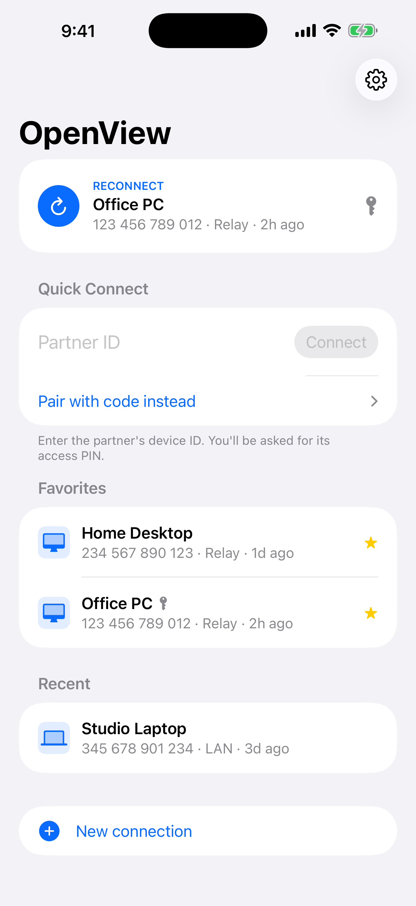
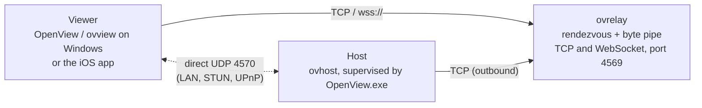

<p align="center">
  
</p>

<h1 align="center">OpenView</h1>

<p align="center">
  <b>Self-hosted, open-source remote desktop for Windows with an iOS client.</b>
</p>

<p align="center">
  <a href="https://github.com/viceduong/openview/actions/workflows/ci.yml"></a>
  <a href="https://github.com/viceduong/openview/releases/latest"></a>
  <a href="LICENSE"></a>
  
</p>

OpenView lets you reach your Windows PC from another PC or from your iPhone
or iPad, through a relay **you** run. No account, no cloud service, no
telemetry: the host, the relay and the apps are all in this repository,
written in Rust (Swift for the iOS UI) and end-to-end encrypted.

> [!TIP]
> **Quick start in 60 seconds**
> 1. Download `OpenView-<version>-setup.exe` from
>    [Releases](https://github.com/viceduong/openview/releases/latest) and
>    run it on the PC you want to reach (no administrator rights needed).
> 2. Note the **ID** and **PIN** it shows. It runs a relay on that PC
>    (TCP 4569) and is reachable as soon as the status reads *Ready*.
> 3. On a second PC on the same network, open OpenView: the first PC appears
>    under *Computers on this network*. Click it, enter the PIN, done.
>
> Reaching it from outside your network: see
> [Reaching the PC from anywhere](#reaching-the-pc-from-anywhere).

<p align="center">
  
  &nbsp;
  
</p>

## Features

- **Share this PC with an ID and a PIN**, or with a one-time pairing code
  for attended support. PINs and codes are verified with SPAKE2, so they
  cannot be guessed offline, and wrong guesses are throttled.
- **Control it from a PC or a phone.** A native Windows viewer (Direct2D)
  and an iOS / iPadOS app (SwiftUI + Metal) with trackpad-style touch,
  hardware-keyboard and iPad pointer support.
- **Fast screen streaming.** DXGI Desktop Duplication, lossless tiles with
  scroll detection, content-aware JPEG, and hardware H.264 for high-motion
  regions; adapts to the link automatically.
- **Relay first, direct when possible.** Sessions start through a relay
  that works behind any NAT, then move to a direct UDP path (LAN, STUN,
  UPnP) and fall back if it drops. On a LAN, no relay is needed at all.
- **Audio, clipboard, files, chat**, multi-monitor, session recording.
- **Easy to deploy.** Per-user installer or portable zip for Windows;
  a single static `ovrelay` binary or Docker image for Linux.

## Why OpenView?

|  | OpenView | RustDesk | TeamViewer | AnyDesk | VNC (e.g. TigerVNC) |
|---|---|---|---|---|---|
| Open source | Yes (MIT) | Yes (AGPL-3.0) | No | No | Yes (most implementations) |
| Self-hosted relay / server | Yes | Yes | No | Paid on-premises edition | Not needed (direct connection) |
| Works without an account | Yes | Yes | Basic use | Basic use | Yes |
| End-to-end encryption | Yes | Yes | Yes (vendor-stated) | Yes (vendor-stated) | Depends on implementation |
| iOS client | Yes (viewer) | Yes | Yes | Yes | Third-party apps |
| Windows host | Yes | Yes | Yes | Yes | Yes |
| macOS / Linux host | Not yet | Yes | Yes | Yes | Yes |
| Price | Free | Free; paid server edition | Free for personal use; paid licenses | Free for personal use; paid licenses | Free (most implementations) |

<sub>Trademarks belong to their respective owners. Comparison as of 2026, to
the best of our knowledge, based on each product's public documentation;
check the vendors' sites for current details.</sub>

## Platform support

| Component | Windows 10/11 (x64) | Linux (x86_64, aarch64) | Docker | iOS / iPadOS 15.6+ | macOS |
|---|---|---|---|---|---|
| Host (be controlled) | Yes | — | — | — | — |
| Viewer (control) | Yes | — | — | Yes | — |
| Relay (`ovrelay`) | Yes | Yes | Yes | — | Builds from source |

## Download and install

Get the latest build from
[Releases](https://github.com/viceduong/openview/releases/latest):

| File | What it is |
|---|---|
| `OpenView-<version>-setup.exe` | Per-user installer for Windows 10/11 x64: installs to `%LOCALAPPDATA%\Programs\OpenView`, optional start at sign-in and firewall rules. |
| `OpenView-<version>-windows-x64-portable.zip` | Portable: unzip anywhere and run `OpenView.exe`; data stays in the `data` folder next to it. |
| `ovrelay-<version>-linux-<arch>.tar.gz` | Static relay for Linux (`x86_64`, `aarch64`) with a systemd unit. |
| `OpenView-<version>-ios-unsigned.ipa` | iOS app, unsigned: sideload with Sideloadly or AltStore, or [build it yourself](docs/BUILDING.md#ios-app). |
| `SHA256SUMS` | Checksums. Every file also has a GitHub build provenance attestation (`gh attestation verify <file> --repo viceduong/openview`). |

> [!NOTE]
> The Windows binaries are not code-signed yet. SmartScreen may show
> "Windows protected your PC": choose **More info > Run anyway** after
> checking the download against `SHA256SUMS`.

Upgrading, uninstalling, portable mode, data locations, firewall, running a
relay on Linux or in Docker: **[docs/INSTALL.md](docs/INSTALL.md)**.

## Using it

1. **On the PC you want to reach**, run **OpenView.exe**. The *Allow remote
   control* card shows **YOUR ID** and a **PIN** (kept in Windows Credential
   Manager; **Change** sets your own). Closing the window keeps OpenView in
   the tray; **Settings > Start OpenView at sign-in** keeps the PC reachable
   after a restart.
2. **From another PC**, open **Settings > Relay** and enter the relay
   address (an IP or host name with an optional port, default **4569**, or a
   `wss://` URL), then enter the partner's **ID** and **PIN** and press
   **Connect**. PCs on the same network appear under *Computers on this
   network* and connect over the LAN (UDP 4571) without a relay.
3. **From iPhone or iPad**, enter the relay on first launch (for example
   `192.168.1.20:4569` or `wss://relay.example.com/relay`) and add the PC
   with its ID and PIN. PCs on the same Wi-Fi appear under *On this
   network*.

### Reaching the PC from anywhere

Every session first meets at a relay both sides can reach; the relay only
forwards encrypted bytes. Pick one:

- **Put the relay on the PC behind an HTTPS reverse proxy or tunnel**
  (Caddy, nginx, a Cloudflare Tunnel, …) pointing at `http://127.0.0.1:4569`;
  clients then use `wss://relay.example.com/relay`.
- **Run `ovrelay` on a small server**: a static Linux binary, a Docker
  image or a systemd service ([guide](docs/INSTALL.md)).
- **Use a VPN you already have** (WireGuard, Tailscale, …) and use the PC's
  VPN address as the relay.

Every command-line flag and more recipes: **[docs/USAGE.md](docs/USAGE.md)**.

## How it works



1. The host connects **out** to the relay and parks under its device ID (or
   a one-time pairing code). No inbound port is required on the host.
2. The viewer dials the relay with the ID; the relay pairs the two
   connections and pipes bytes. It never sees keys or content.
3. Host and viewer run an authenticated handshake end to end: X25519
   (ephemeral + static) signed with Ed25519, SPAKE2 for the PIN or pairing
   code, then ChaCha20-Poly1305 records with an anti-replay window. When a
   direct UDP path works, the session moves onto it without reconnecting.

More: [architecture](docs/ARCHITECTURE.md), [wire protocol](docs/WIRE_PROTOCOL.md),
[media pipeline](docs/MEDIA_PIPELINE.md), [glossary](docs/README.md#glossary),
[security policy](SECURITY.md).

## FAQ

**Can I control UAC prompts, the lock screen or the sign-in screen?**
Not yet. The host runs as the signed-in user, so Windows shows those
secure-desktop screens only on the physical display. A service-based host
is on the roadmap.

**Will there be a macOS or Linux host?**
It is planned but not started; the protocol and relay are portable, the
screen capture and input injection are Windows-specific today.
Contributions are welcome.

**Is it secure?**
All session content is end-to-end encrypted; the relay sees only
ciphertext and connection metadata. PINs and pairing codes never cross the
network and cannot be brute-forced offline. Use a strong PIN, keep the
apps updated, and see the [threat model](SECURITY.md#threat-model-summary).
The code has not had an independent audit yet.

**Do I need a relay?**
Not on a LAN: hosts on the same network are found by mDNS and connected
directly. Across the internet you need a relay both sides can reach (the
Windows app can run one for you), or a VPN.

## Roadmap

- Windows service host for UAC prompts, the lock screen and sign-in.
- macOS and Linux hosts.
- iOS: microphone uplink and chat / special-key UI polish.
- Audio in recordings; acoustic echo cancellation for full-duplex audio.
- Several viewers per host.
- Post-quantum hybrid key exchange.

Known bugs and limitations: [docs/KNOWN_ISSUES.md](docs/KNOWN_ISSUES.md).

## Build from source

**Windows**: [Rust via rustup](https://rustup.rs), the
[Visual Studio Build Tools](https://visualstudio.microsoft.com/visual-cpp-build-tools/)
(*Desktop development with C++*) and [CMake](https://cmake.org/download/)
(compiles libopus), then:

```powershell
git clone https://github.com/viceduong/openview
cd openview
cargo build --release      # target\release\OpenView.exe, ovhost.exe, ovview.exe, ovrelay.exe
cargo test --workspace
```

**Linux relay**: `cargo build --release -p ovrelay`, or
`docker build -f packaging/docker/Dockerfile .`.

**iOS** (Mac with Xcode 15+ and [XcodeGen](https://github.com/yonaskolb/XcodeGen)):
`ios/build_ios.sh --sim` or `ios/build_ios.sh --device`.

Full instructions: **[docs/BUILDING.md](docs/BUILDING.md)** and
[ios/README.md](ios/README.md). All documentation: **[docs/](docs/README.md)**.

## Contributing and security

Bug reports, fixes and features are welcome: see
**[CONTRIBUTING.md](CONTRIBUTING.md)** and the
[Code of Conduct](CODE_OF_CONDUCT.md). Please report vulnerabilities
privately as described in **[SECURITY.md](SECURITY.md)**.

## License

OpenView is released under the [MIT License](LICENSE).

The Windows app's user interface is built with [Slint](https://slint.dev),
used under the
[Slint Royalty-free Desktop, Mobile, and Web Applications License](https://slint.dev/terms-and-conditions)
(the About page shows the required "Made with Slint" attribution). Release
packages include `THIRD_PARTY_LICENSES.txt` with the licenses of all bundled
Rust crates and of the bundled C libraries libopus and zstd.

OpenView builds on excellent open-source work, including
[RustCrypto](https://github.com/RustCrypto), [dalek-cryptography](https://github.com/dalek-cryptography),
[Slint](https://slint.dev), [windows-rs](https://github.com/microsoft/windows-rs),
[Opus](https://opus-codec.org), [zstd](https://facebook.github.io/zstd/),
[clap](https://github.com/clap-rs/clap), [tracing](https://github.com/tokio-rs/tracing)
and [XcodeGen](https://github.com/yonaskolb/XcodeGen).
