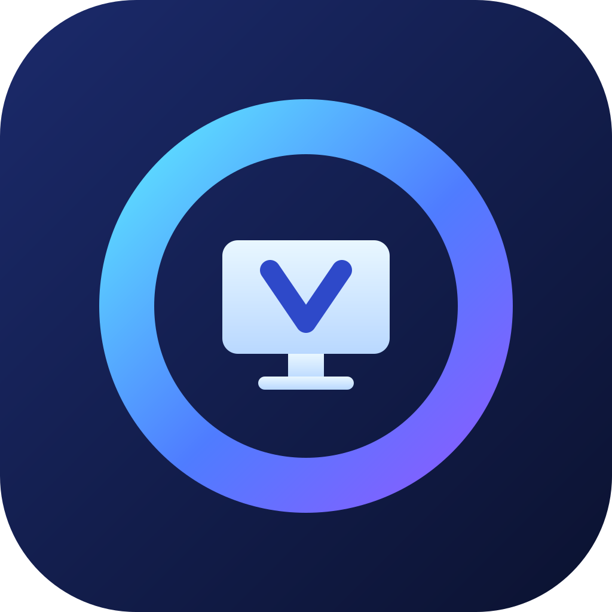
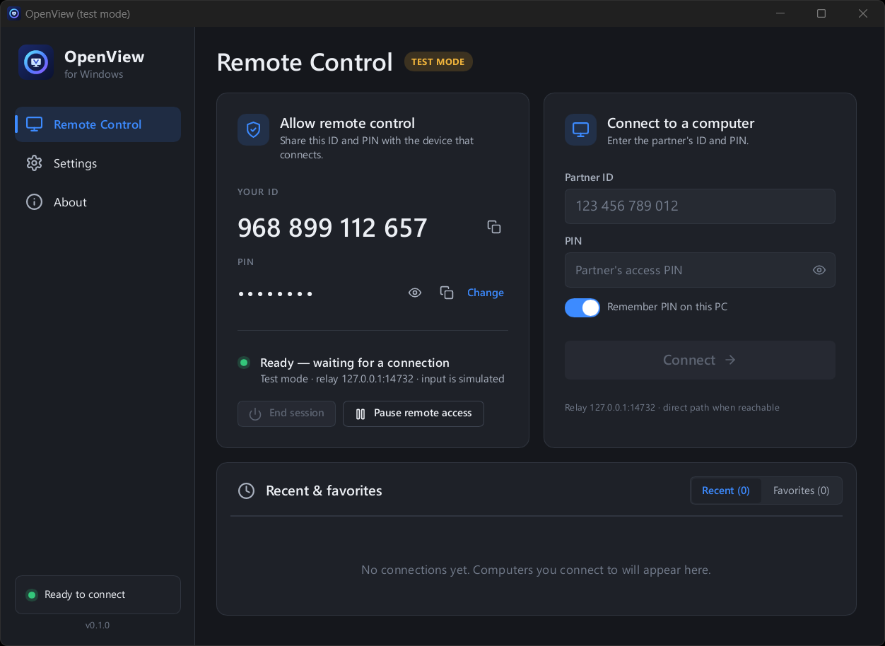
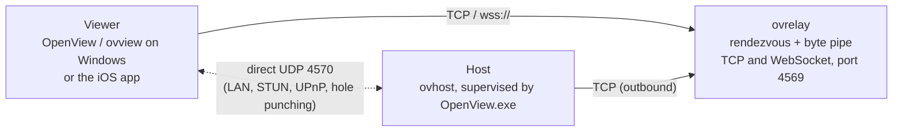

<p align="center">
  
</p>

<h1 align="center">OpenView</h1>

<p align="center">
  <b>Self-hosted, open-source remote desktop for Windows with an iOS client.</b>
</p>

<p align="center">
  <a href="https://github.com/OWNER/openview/actions/workflows/ci.yml"></a>
  <a href="https://github.com/OWNER/openview/releases/latest"></a>
  <a href="LICENSE"></a>
  
</p>

OpenView lets you reach your Windows PC from another PC or from your iPhone
or iPad, through a relay **you** run. There is no account, no cloud service
and no telemetry: the host, the relay and the apps are all in this
repository, written in Rust (Swift for the iOS UI), end-to-end encrypted.

<p align="center">
  
</p>

## Features

- **Share this PC with an ID and a PIN.** `OpenView.exe` shows a stable
  device ID and an access PIN; anyone with both can connect. The PIN is
  verified with a PAKE (SPAKE2), so it cannot be guessed offline, and
  repeated wrong guesses are throttled.
- **Control another PC or use your phone.** A native Windows viewer
  (Direct2D) and an iOS / iPadOS app (SwiftUI + Metal) with trackpad-style
  touch, hardware-keyboard and iPad pointer support.
- **Fast screen streaming.** DXGI Desktop Duplication capture with dirty
  rectangles, lossless tiles (DEFLATE / zstd / LZ4), scroll detection,
  content-aware JPEG, and hardware H.264 for high-motion regions; adapts to
  the link automatically.
- **Relay first, direct when possible.** Sessions start through a relay
  that works behind any NAT, then upgrade to a direct UDP path (LAN, STUN,
  UPnP) and fall back to the relay if it drops.
- **Audio, clipboard and files.** System sound and microphone (Opus, full
  duplex), bidirectional clipboard text, file transfer both ways.
- **Multi-monitor**, session recording (`.ovrec`) with playback and frame
  export, and a tray app that keeps the PC reachable after sign-in.
- **Easy to deploy.** Per-user installer (no administrator rights) or a
  portable zip; statically linked binaries with no runtime dependencies on
  Windows 10 and 11 (x64).

## Download and install

Get the latest build from the
[Releases](https://github.com/OWNER/openview/releases/latest) page:

| File | What it is |
|---|---|
| `OpenView-<version>-setup.exe` | Per-user installer: installs to `%LOCALAPPDATA%\Programs\OpenView`, Start menu entry, optional start at sign-in and firewall rules. No administrator rights needed. |
| `OpenView-<version>-windows-x64-portable.zip` | Portable: unzip anywhere and run `OpenView.exe`; settings stay in the `data` folder next to it. |
| `OpenView-<version>-ios-unsigned.ipa` | iOS app, unsigned: sideload with Sideloadly or AltStore, or build it yourself (see [Building](docs/BUILDING.md#ios-app)). |
| `SHA256SUMS` | Checksums of the files above. |

> [!NOTE]
> The Windows binaries are not code-signed yet. Windows SmartScreen may
> show "Windows protected your PC" on first start: choose **More info >
> Run anyway**, after checking the download against `SHA256SUMS`.

Details on upgrading, uninstalling, portable mode, data locations, the
firewall and autostart: **[docs/INSTALL.md](docs/INSTALL.md)**.

## Quick start

### 1. On the PC you want to reach

Run **OpenView.exe**. The *Allow remote control* card shows **YOUR ID** and
a **PIN** (generated on first start, kept in Windows Credential Manager;
**Change** sets your own). By default the app also runs a relay on this PC
(TCP **4569**) and parks its host on it, so the PC is reachable as soon as
the status reads *Ready*.

Closing the window keeps OpenView running in the tray. Turn on
**Settings > Start OpenView at sign-in** to keep the PC reachable after a
restart.

### 2. Connect from another PC

In OpenView on the second PC, open **Settings > Relay** and enter the relay
address: an IP or host name with an optional port (default **4569**), for
example `192.168.1.20` for the first PC's relay on your LAN, or a
`wss://` URL for a relay behind an HTTPS proxy (see below). Then enter the partner's **ID** and **PIN** under
*Connect to a computer* and press **Connect**.

**Same network?** PCs running OpenView on your network appear under
*Computers on this network* (found by mDNS). Connecting to one goes
straight over the LAN (UDP 4571), with no relay needed.

### 3. Connect from iPhone or iPad

On first launch the app asks for a relay. Enter `192.168.1.20:4569` (plain
TCP on your LAN) or a WebSocket URL such as
`wss://relay.example.com/relay` (see below), then add the PC with its ID and
PIN. PCs on the same Wi-Fi appear under *On this network* (Bonjour); tap
one to connect directly over the LAN, no relay needed.

### Reaching the PC from outside your network

Every session first meets at a relay that both sides can reach; the relay
only forwards encrypted bytes. Pick one:

- **Expose the relay on this PC through an HTTPS reverse proxy or tunnel.**
  `ovrelay` accepts WebSocket clients at `GET /relay` on the same port as
  raw TCP. Point a reverse proxy (Caddy, nginx, …) or a tunnel service (for
  example a Cloudflare Tunnel) at `http://127.0.0.1:4569` and the iOS app can
  use `wss://relay.example.com/relay` from anywhere, with TLS terminated by
  the proxy; so can OpenView on other Windows PCs. The PC's own host keeps
  using `127.0.0.1:4569`.
- **Run `ovrelay` on a server** (a small VPS is plenty) and open its TCP
  port: `ovrelay --bind 0.0.0.0:4569`. Point every device at it. Every app
  accepts an IP or host name with an optional port (raw TCP), or a `ws://` /
  `wss://` URL (WebSocket).
- **Use a VPN you already have** (WireGuard, Tailscale, …) and use the PC's
  VPN address as the relay.

Once connected, OpenView tries to switch to a direct UDP path (port
**4570** on the host; UPnP maps it when the router allows it) and stays on
the relay otherwise.

Command-line use (`ovhost`, `ovview`, `ovrelay` without the GUI), every
flag and more recipes: **[docs/USAGE.md](docs/USAGE.md)**.

## How it works



1. The host connects **out** to the relay and parks under its device ID
   (or a one-time pairing code). No inbound port is required on the host.
2. The viewer dials the relay with the ID; the relay pairs the two
   connections and pipes bytes between them. It never sees keys or content.
3. Host and viewer run an authenticated handshake end to end, then exchange
   AEAD records. In parallel they exchange direct-path candidates; when a
   UDP path works, the session moves onto it without reconnecting.

**Cryptography** (`crates/ovcore`):

- Each device has an **Ed25519** signing identity and an **X25519** static
  key derived from one seed; its fingerprint is a hash of the public key.
- The handshake combines **ephemeral and static X25519** Diffie-Hellman,
  signs the exchange with Ed25519 and binds everything to a transcript hash
  (HKDF-SHA256 key schedule).
- **PIN access uses SPAKE2** with key confirmation in both directions: a
  wrong PIN fails the handshake, and nothing on the wire allows offline
  guessing. Hosts rate-limit attempts (lockout from 30 s doubling to 15
  min).
- Records are encrypted with **ChaCha20-Poly1305**, separate keys per
  direction, with sequence numbers in the authenticated data.

More: [architecture](docs/ARCHITECTURE.md), [wire protocol](docs/WIRE_PROTOCOL.md),
[media pipeline](docs/MEDIA_PIPELINE.md), [security policy](SECURITY.md).

## Build from source

**Windows** (host, viewer, relay, GUI): install
[Rust via rustup](https://rustup.rs) and the
[Visual Studio Build Tools](https://visualstudio.microsoft.com/visual-cpp-build-tools/)
with the *Desktop development with C++* workload, and
[CMake](https://cmake.org/download/) (`winget install Kitware.CMake`, used to
compile libopus), then:

```powershell
git clone https://github.com/OWNER/openview
cd openview
cargo build --release      # target\release\OpenView.exe, ovhost.exe, ovview.exe, ovrelay.exe
cargo test --workspace
powershell -ExecutionPolicy Bypass -File scripts\package.ps1   # optional: portable zip + installer in dist\
```

The toolchain version comes from `rust-toolchain.toml`. `ovrelay` is plain
`std` Rust and also builds on Linux and macOS.

**iOS**: on a Mac with Xcode 15+, [XcodeGen](https://github.com/yonaskolb/XcodeGen)
(`brew install xcodegen`) and the Rust iOS targets:

```bash
ios/build_ios.sh --sim       # simulator app
ios/build_ios.sh --device    # unsigned .ipa for sideloading
```

Full instructions: **[docs/BUILDING.md](docs/BUILDING.md)** and
[ios/README.md](ios/README.md).

## Documentation

| | |
|---|---|
| [Install, upgrade, uninstall](docs/INSTALL.md) | installer vs portable, data locations, firewall, autostart |
| [Usage](docs/USAGE.md) | GUI walkthrough, every command-line flag, recipes |
| [Troubleshooting](docs/TROUBLESHOOTING.md) | error messages and fixes, logs |
| [Known issues](docs/KNOWN_ISSUES.md) | open bugs and limitations |
| [Building](docs/BUILDING.md) | Windows and iOS builds, packaging, tests |
| [Architecture](docs/ARCHITECTURE.md) | how the crates fit together |
| [All documentation](docs/README.md) | wire protocol, media pipeline, iOS app, per-crate references |

## Security

OpenView gives full control of a computer to whoever authenticates, so
choose a strong PIN and keep it private. Please report vulnerabilities
privately as described in **[SECURITY.md](SECURITY.md)**, which also lists
the threat model and current limitations (for example, the host runs as the
signed-in user and cannot control UAC prompts or the lock screen).

## Contributing

Bug reports, fixes and features are welcome. See
**[CONTRIBUTING.md](CONTRIBUTING.md)** for the development setup, the checks
CI runs and the commit style, and follow the
[Code of Conduct](CODE_OF_CONDUCT.md).

## License

OpenView is released under the [MIT License](LICENSE).

The Windows app's user interface is built with [Slint](https://slint.dev),
used under the
[Slint Royalty-free Desktop, Mobile, and Web Applications License](https://slint.dev/terms-and-conditions)
(the About page shows the required "Made with Slint" attribution). Release
packages include `THIRD_PARTY_LICENSES.txt` with the licenses of all bundled
Rust crates and of the bundled C libraries libopus and zstd.

## Acknowledgements

OpenView builds on excellent open-source work, including
[RustCrypto](https://github.com/RustCrypto) (ChaCha20-Poly1305, SPAKE2,
SHA-2, HMAC), [dalek-cryptography](https://github.com/dalek-cryptography)
(X25519, Ed25519), [Slint](https://slint.dev), [windows-rs](https://github.com/microsoft/windows-rs),
[Opus](https://opus-codec.org), [zstd](https://facebook.github.io/zstd/),
[clap](https://github.com/clap-rs/clap), [tracing](https://github.com/tokio-rs/tracing)
and [XcodeGen](https://github.com/yonaskolb/XcodeGen).
