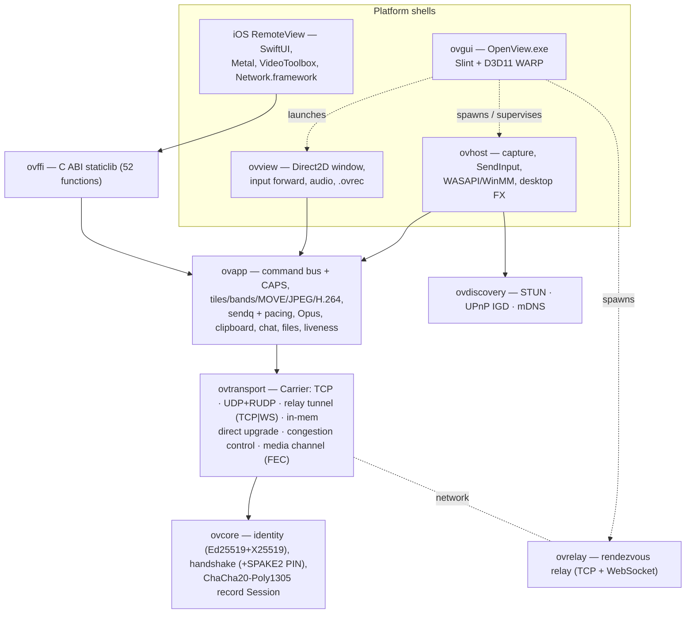

# OpenView architecture

This is the top-level map. Each box links to a deeper reference:
per-crate docs in [`crates/`](crates/), the wire format in
[`WIRE_PROTOCOL.md`](WIRE_PROTOCOL.md), the screen/audio path in
[`MEDIA_PIPELINE.md`](MEDIA_PIPELINE.md), the phone app in
[`IOS_APP.md`](IOS_APP.md), and operator instructions in [`USAGE.md`](USAGE.md).

## 1. Goals and shape

OpenView is a self-hosted remote desktop: a **host** that shares
its screen and accepts input, a **viewer** (desktop and iPhone) that controls
it, and a **relay** that brokers sessions across NAT and gets out of the way
once a direct UDP path is established.

Design rules that every layer follows:

1. **Rust owns all protocol and media logic.** Platform shells (Win32 host,
   Direct2D viewer, Slint GUI, SwiftUI app) only do OS I/O: capture, input,
   audio devices, rendering, sockets the OS insists on owning.
2. **One encrypted command channel, everything negotiated.** All traffic is
   AEAD records on channel 0; each newer format is opt-in through a `CAPS`
   bit, so an old peer still gets DEFLATE full frames.
3. **Send less, never queue stale.** Dirty tiles, MOVE, JPEG-first, H.264
   only for motion; a latest-wins mailbox replaces stale frames; control
   traffic always jumps the queue.
4. **Relay first, direct when possible.** A session always starts through the
   relay (works everywhere) and upgrades in place to direct UDP; the relay
   remains the fallback.
5. **Sans-IO cores, testable without a network.** Handshake, RUDP, congestion
   control, codecs and file transfer are pure state machines exercised by
   in-memory and loopback tests.

## 2. Layer diagram



`ovgui` does **not** link the networking crates; it drives the binaries as
child processes and parses the JSON-lines status events they print on
stdout into UI state; their human-readable logs (stderr) go to log files
([`crates/ovgui.md`](crates/ovgui.md), event schema in
[`crates/ovcommon.md`](crates/ovcommon.md)).

## 3. Crates

| Crate | Kind | Responsibility | Reference |
|---|---|---|---|
| `ovcore` | lib | Identity (`OVID1` seed → Ed25519 + X25519), fingerprint & 6-digit pairing code, versioned handshake (HELLO / READY / CONFIRM), SPAKE2 PIN authentication + attempt throttling, HKDF transcript key schedule, AEAD record `Session`, typed errors | [ovcore.md](crates/ovcore.md) |
| `ovtransport` | lib | `Carrier` trait and implementations; RUDP; direct-path engine (probes, candidates, REBIND); delay-based CC; unreliable FEC media channel; relay client over TCP (IP or hostname) or WebSocket (`ws://` / `wss://`, feature `ws-client`); RFC 6455 codec (`ws`) shared with `ovrelay` | [ovtransport.md](crates/ovtransport.md) |
| `ovrelay` | lib + bin | Pairs two parties by session ID, then relays tunnel frames opaquely; RFC 6455 listener; connection / per-IP / pending caps | [ovrelay.md](crates/ovrelay.md) |
| `ovdiscovery` | lib | STUN binding (public mapping), UPnP IGD port mapping, mDNS/DNS-SD | [ovdiscovery.md](crates/ovdiscovery.md) |
| `ovapp` | lib | `TerminalSession` command bus (36 opcodes), CAPS (16 bits), screen encoder/decoder family, H.264 via Media Foundation, `PrioritySender`/`FrameMailbox`, `LinkPacer`, audio, clipboard, chat, file transfer, recording container | [ovapp.md](crates/ovapp.md) |
| `ovhost` | bin | Windows host: DXGI/GDI capture, cursor, input injection, mic / loopback / speaker, desktop effects + crash-safe cleanup, direct networking | [ovhost.md](crates/ovhost.md) |
| `ovview` | bin | Windows viewer: Direct2D/GDI presentation with area/sharpen scaling, HUD, hotkeys, input forwarding, audio, record/play/export | [ovview.md](crates/ovview.md) |
| `ovgui` | bin (`OpenView.exe`) | Desktop front end: ID/PIN, partner list, settings, tray, Credential Manager; supervises the other binaries | [ovgui.md](crates/ovgui.md) |
| `ovcommon` | lib | Shared plumbing of the Windows binaries: data-dir rule (`%LOCALAPPDATA%\OpenView`, portable mode, migrations, `Downloads\OpenView`), relay address syntax (`RelayAddr`: IP, `hostname[:port]`, `ws://` / `wss://`), JSON-lines status-event schema, `tracing` logging setup (feature `logging`) | [ovcommon.md](crates/ovcommon.md) |
| `ovffi` | staticlib | C ABI for iOS: identity, session create/pump, relay/WS/datagram bridging, screen/video/audio/cursor/clipboard/file sinks, input | [ovffi.md](crates/ovffi.md) |

## 4. Session lifecycle

```mermaid
sequenceDiagram
  participant V as Viewer
  participant R as ovrelay
  participant H as Host
  H->>R: connect (TCP or WS), park under session ID
  V->>R: connect with pairing code / device ID
  R-->>V: 'O' — paired
  R-->>H: 'O' — paired
  V->>H: HELLO (ephemeral X25519, identity, auth blob / SPAKE2 msg)
  H->>V: HELLO + READY (Ed25519 sig over the transcript [+ PIN key confirmation])
  V->>H: CONFIRM (PIN mode: client key confirmation)
  Note over V,H: HKDF(transcript) → per-direction ChaCha20-Poly1305 keys
  V->>H: CAPS
  H->>V: CAPS
  Note over V,H: format set fixed by the intersection of CAPS bits
  V->>H: DIRECT candidates (if CAP_DIRECT both sides)
  H->>V: DIRECT candidates (STUN / UPnP / LAN)
  V-->>H: UDP probes (hole punch)
  Note over V,H: records migrate to the direct UDP link (RUDP + CC)<br/>media channel opens (CAP_MEDIA); relay kept as fallback
  loop session
    H->>V: tiles / MOVE / JPEG / H.264, cursor, audio
    V->>H: input, clipboard, files, QUALITY_SET, PONG
  end
```

Wire-level details for every step: [`WIRE_PROTOCOL.md`](WIRE_PROTOCOL.md).
Command IDs and payloads: [`crates/ovapp.md`](crates/ovapp.md).

## 5. Process and thread model

### Host (`ovhost`)

| Thread | Role |
|---|---|
| session (main) | Owns `TerminalSession`; pumps input (injected on decode), sends with priority, keepalive, clipboard/cursor polls, audio encode. Blocks in `netwait::Wakeup::wait` (socket / mailbox / mic / deadline) — no fixed sleep. |
| `ovhost-capture` | Owns the DXGI device / GDI DCs; grab → `UpdateEncoder` + `VideoSession` → `FrameMailbox`; MMCSS "Capture". |
| mic | `--mic` / `--mic-synth` / `--system-audio` capture → session thread. |
| speaker | `--audio`: plays viewer mic via WinMM. |
| `ovhost-upnp` | Creates / refreshes / removes the UPnP mapping. |

Send priority: control (PONG, PING, cursor, audio, clipboard, chat, monitors)
always first, then **one** frame record per loop turn, at most one frame in
flight, gated by the `LinkPacer` window.

### Viewer (`ovview`)
Window/render thread with the session pump, a speaker thread (always running,
playback toggled by F2), optional mic thread, stdin reader (currently
undrained — see KNOWN_ISSUES BUG-2).

### iOS
Session and Swift bridges (`NwUdpBridge`, `RelayWebSocket`) are confined to
the main queue; a timer / wake sink drives `ov_session_pump`; frames are
handed to Metal as dirty rects; H.264 goes to an `AVSampleBufferDisplayLayer`
overlay. See [`IOS_APP.md`](IOS_APP.md).

### GUI (`OpenView.exe`)
Slint event loop on the UI thread; worker threads read child stdout/stderr
and post events to the UI; Job Object ties children to the GUI's lifetime.

## 6. Security model

- **Identity:** 32-byte master seed → Ed25519 (signing) + X25519; fingerprint
  = SHA-256(Ed25519 pub)[..16]; pairing code derived from the fingerprint.
- **Handshake (v2):** ephemeral + static X25519 → HKDF-SHA256 per-direction
  keys salted with the transcript hash; READY is an Ed25519 signature over the
  transcript; attended sessions bind the pairing code. Unattended sessions
  authenticate the PIN with **SPAKE2** (balanced PAKE): the PAKE key is mixed
  into the key schedule and confirmed by MACs in both directions, so nothing
  on the wire allows an offline PIN guess and each attempt tests one guess.
  The host rate-limits PIN attempts (lockout from 30 s doubling to 15 min)
  and tells clients "too many attempts" with a retry-after. Old (v1) peers
  get an explicit incompatible-version error.
- **Hostile input:** handshake, record, command, band-container and
  WebSocket parsers are bounds-checked and covered by smoke-fuzz tests and
  cargo-fuzz targets (`fuzz/`); received files are capped (4 concurrent,
  256 MiB buffered) and their names sanitized; the relay caps connections
  (total, per IP) and parked sessions.
- **Records:** ChaCha20-Poly1305 with per-direction sequence counters; no
  reorder window, so lower layers must deliver in order.
- **iOS:** direct-path host keys pinned trust-on-first-use; PINs in Keychain.
- **Windows GUI:** PINs in Credential Manager.
- Open issues: [`KNOWN_ISSUES.md`](KNOWN_ISSUES.md#security).

## 7. Ports and files

| Item | Value |
|---|---|
| Relay | TCP 4569 (the default of the relay and every client; WebSocket on the same port, or `ws://` / `wss://` through a reverse proxy) |
| Direct path | UDP 4570 (UPnP-mapped when available) |
| LAN sessions | UDP 4571 (`ovhost --lan-port`), no relay |
| mDNS | 224.0.0.251:5353, `_openview._udp.local` (unattended hosts) |
| Received files | `Downloads\OpenView` (desktop host and viewer, never overwriting: `name (2).ext`); app Documents (iOS) |
| Recordings | `%USERPROFILE%\ovrecord\*.ovrec` |
| Data (host identity, GUI settings, logs) | `%LOCALAPPDATA%\OpenView` (`<exe dir>\data` with `portable.txt`; `--data-dir` / `OPENVIEW_DATA_DIR`); see [ovcommon.md](crates/ovcommon.md) |

## 8. Repository layout

```
./
  Cargo.toml            workspace (10 crates)
  crates/<crate>/       sources, tests/, examples/
  assets/               app icon (ico/svg) + winres.rs (icon, manifest, VERSIONINFO; included by build.rs)
  scripts/              e2e_relay.sh, e2e_lan.sh
  ios/                  build_ios.sh, RemoteView/ (XcodeGen project, Swift, Metal)
  docs/                 this documentation
  CHANGELOG.md README.md LICENSE
```
