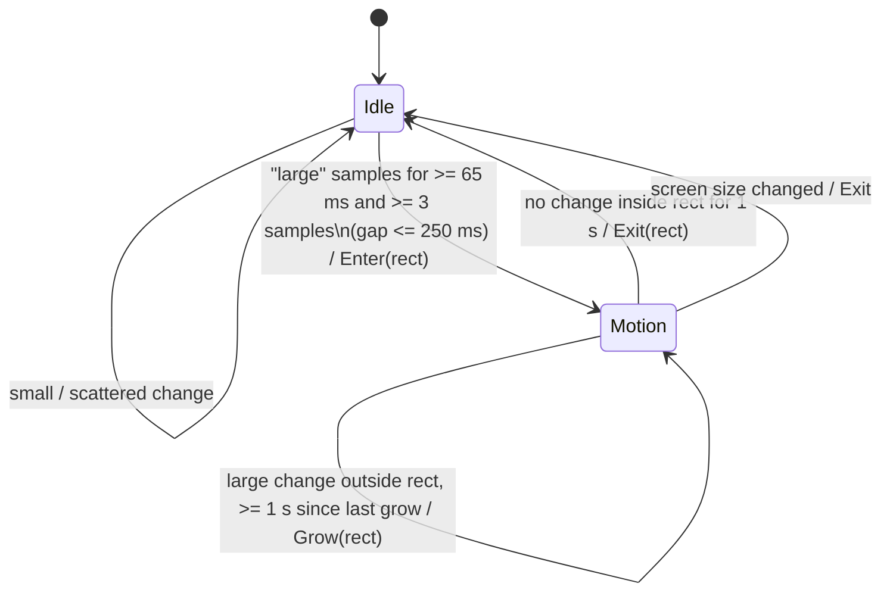
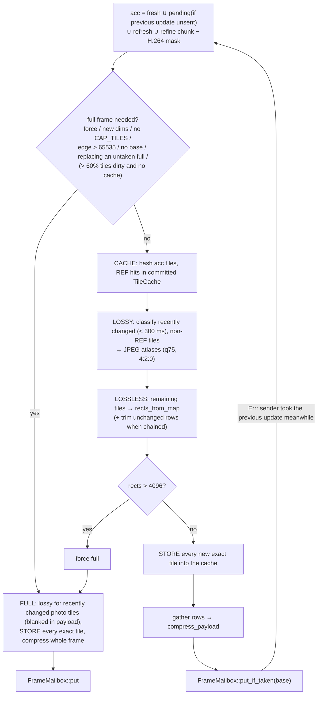
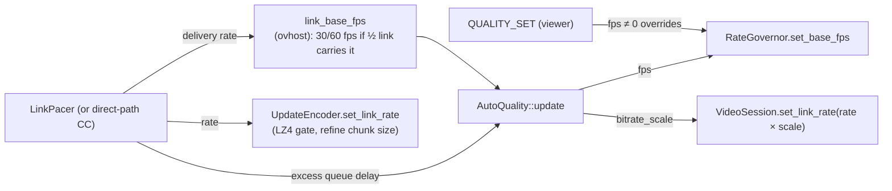
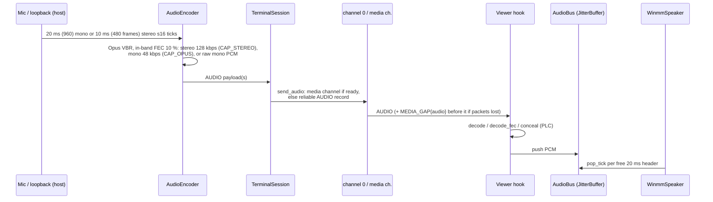

# OpenView media pipeline

This document follows a screen change and an audio tick from host capture to
viewer display. Everything here is derived from the code:

- mainly `crates/ovapp/src/` (see [`crates/ovapp.md`](crates/ovapp.md)
  for the reference tables)
- plus the wiring in `crates/ovhost/src/session/` (`capture_loop.rs`,
  `screen.rs`, `hooks.rs`) and `crates/ovview/src/session/`

File references are relative to `crates/`.

---

## 1. The big picture

There is a single encrypted command channel (AEAD record channel 0), with an
optional unreliable media side-channel when a direct UDP path is up.
Everything else is layered on that channel.

```mermaid
flowchart LR
  subgraph Host["ovhost (capture thread + session thread)"]
    CAP["Capture<br/>DXGI dup / GdiScreen"] --> ENC["UpdateEncoder::submit_ex<br/>(ovapp/src/sendq/)"]
    CAP --> VS["VideoSession::on_capture<br/>(ovapp/src/video/)"]
    ENC -->|"full frame / tile delta"| MB["FrameMailbox<br/>latest-wins slot + video FIFO"]
    VS -->|"H.264 AU / VIDEO_END"| MB
    MIC["Mic / WASAPI loopback"] --> AENC["AudioEncoder::encode_ticks"]
    MB --> PS["PrioritySender::flush<br/>control first, 1 update in flight"]
    PACER["LinkPacer<br/>(probe PING/PONG)"] -.window.-> PS
    AENC -->|"send_audio"| TS
    PS --> TS["TerminalSession::send<br/>AEAD record ch.0"]
    PS -->|"media_ready"| MEDIA["media channel<br/>(RS-FEC, unreliable)"]
  end
  TS -->|"relay / TCP / UDP(+RUDP) / direct"| NET(("network"))
  MEDIA --> NET
  subgraph Viewer["ovview / iOS ovffi"]
    NET --> PUMP["TerminalSession::pump"]
    PUMP --> SD["ScreenDecoder<br/>(ovapp/src/tiles/)"]
    PUMP --> VD["VideoRx + MfVideoDecoder<br/>GPU picture or blit"]
    PUMP -->|"on_cmd hook"| ADEC["AudioDecoder -> AudioBus/JitterBuffer"]
    SD --> TAKE["take_latest_frame()"]
    VD --> TAKE
    TAKE --> SCALE["Scaler::area_sharpen / GPU"] --> WIN["window"]
    ADEC --> SPK["WinmmSpeaker"]
  end
```



Three ideas shape the whole design:

1. **Send less data.** The host sends only what changed: 64x64 dirty tiles
   instead of whole frames. It turns a scroll into a 12-byte MOVE, sends
   photo-like tiles as JPEG first and refines them later, reuses tiles the
   viewer already holds, and switches high-motion regions to H.264.
2. **Never queue stale pixels.** Screen updates go through a single
   *latest-wins* mailbox, so a slow link always gets the freshest capture,
   never a backlog. Only H.264 units, which form a reference chain, use a
   FIFO.
3. **Keep control traffic fast.** Control records (PONG, cursor, audio,
   input echo) always jump ahead of frame data. Frame data is also held back
   by a delay-based pacing window, so no standing queue builds up in the
   kernel or relay buffers.

---

## 2. Capability negotiation decides the format

When a session starts, the viewer sends `CAPS` and the host replies with its
own (see `TerminalSession::pump`, `Command::Caps` arm in
`ovapp/src/terminal/caps.rs`). The host's encoder follows the viewer's bits
(`UpdateEncoder::set_peer_caps`):

| Viewer advertises | Host may send |
|---|---|
| nothing (old peer) | DEFLATE full frames only (`FRAME_BEGIN` codec 1) |
| `CAP_TILES` | `TILES_BEGIN` deltas against `base_seq` |
| `CAP_ZSTD` | zstd payloads (single or concatenated frames) |
| `CAP_BANDS` (+`CAP_LZ4`) | the Packed band container, with per-band raw/DEFLATE/zstd/LZ4 |
| `CAP_MOVE` + `CAP_BANDS` | copy-rect MOVE records (scroll) |
| `CAP_LOSSY` + `CAP_BANDS` | JPEG atlases for photo-like tiles |
| `CAP_CACHE` + `CAP_BANDS` | tile-cache REF / STORE records |
| `CAP_PALETTE` + `CAP_BANDS` | palette bands: few-colour chunks as palette + 1/2/4-bit indices, then zstd |
| `CAP_VIEWPORT` (host) | the viewer may send `VIEWPORT`; visible tiles go first |
| `CAP_H264` | `VIDEO_BEGIN` H.264 access units (needs a working decoder) |
| `CAP_OPUS` (+`CAP_AUDIO10`) | Opus audio, in 20 ms (or 10 ms) packets |
| `CAP_STEREO` + `CAP_OPUS` | stereo Opus system audio (mono down-mix otherwise) |
| `CAP_HEVC` + `CAP_H264` | HEVC `VIDEO_BEGIN` units instead of H.264 (host with a hardware HEVC MFT; see 3.7) |
| `CAP_LTR` (both) | loss recovery from a long-term reference instead of an IDR (`VIDEO_LTR_ACK` / `VIDEO_RECOVER`, see 3.7) |
| `CAP_RUDP` | the UDP carrier switches to reliable framing |
| `CAP_DIRECT` + `CAP_MEDIA` (both sides) | direct UDP path, delay-based congestion control, unreliable media channel |
| `CAP_MEDIA_PLI` + `CAP_MEDIA` (both) | video recovery requests as repeated PLI datagrams on the media channel (see 3.7) |

A default desktop viewer advertises:

- `LOCAL_CAPS | VIEWER_W2_CAPS | audio_caps()`
- plus `CAP_H264` once `set_video_decoder` installs the Media Foundation
  decoder (`ovview/src/session/mod.rs`)
- plus `CAP_DIRECT | CAP_MEDIA` when `enable_direct` is used

---

## 3. Host: from capture to an encoded update

### 3.1 Capture

`ovhost` grabs a frame with DXGI Desktop Duplication (`ovhost/src/dxgi.rs`),
falling back to `ovapp::gdisrc::GdiScreen` (BitBlt into a top-down 32-bit
DIB). Either way the result is tight BGRA. DXGI also supplies the OS **dirty
rects** (`hints`) and **move rects** (`os_moves`), and the host may keep a
GPU texture for zero-copy H.264 (`VideoSession::set_gpu_frame`).

The capture interval is chosen as follows:

- `RateGovernor` (`ovapp/src/adapt.rs`) snaps to the base fps on any change
  and eases toward `IDLE_FPS = 4` while the screen is static. Each idle step
  multiplies the interval by 1.5.
- **Input wake** (`ovhost/src/session/wake.rs`): every input event the
  host injects (pointer, wheel, key, text) notifies the capture thread. Its
  next capture is pulled in to one active frame interval after the previous
  one (at once when that is past), and for `INPUT_BOOST = 750 ms` after the
  last input the governor stays at the full rate (an unchanged capture does
  not ease it down), so the reaction is captured within a frame instead of
  at the next idle tick (up to 250 ms). GDI / test-pattern sleeps end on the
  input; DXGI waits end on the screen change it causes and use 4 ms slices
  while boosted. Measured with the input-to-photon probe (`--test-pattern
  video`, loopback relay, 200 presses): p95 141 -> 38-67 ms, p99 174 ->
  97-155 ms (USAGE §2.11).
- The base fps comes from `AutoQuality`, or from a manual `QUALITY_SET`
  (section 6).
- **Viewport priority** (`CAP_VIEWPORT`): the viewer reports the part of
  the remote screen it shows (`VIEWPORT`: rect in remote pixels + zoom; the
  iOS shell on every pan / zoom, throttled to 100 ms; the desktop viewer the
  whole frame at its window scale). In a plain tile delta the encoder sends
  the visible changed tiles and defers the rest into the refinement backlog
  (sent once settled, visible ones first, never later than
  `OFFVIEW_MAX_DEFER = 500 ms`). Downsampling the H.264 region for a
  zoomed-out viewer is not done (it would need a scaled encode surface).

### 3.2 Change detection and tiling

`UpdateEncoder::submit_ex(px, w, h, hints, os_moves, mask, refresh, mailbox)`
(`ovapp/src/sendq/encoder.rs`) compares the capture with `last_px`, the host's mirror
of what the viewer will hold:

```
diff_tiles(last_px, px, ..., hints, &mut fresh)     // ovapp/src/tiles/mod.rs
  for each 64-px tile row with candidates:
    for each pixel row:  memcmp whole row; if different,
      compare only the not-yet-dirty candidate tiles of that row
```

Nothing changed, with no refresh owed and no refinement due ->
`SubmitOutcome::Unchanged`. Nothing is queued.

### 3.3 Scroll -> MOVE

The encoder looks for a MOVE only when all of these hold:

- the viewer has `CAP_MOVE | CAP_BANDS`
- the previous update has already been taken by the sender, so the viewer
  will hold exactly `last_px`
- no H.264 mask or refresh is involved

`find_move` then searches in two stages:

1. **OS move rects first.** Each is checked with `scroll::verify_move` and
   accepted when at least 90 % of its rows match.
2. **Then the detector,** but only when at least 8 tiles are dirty.
   `scroll::detect_vertical` runs over the bounding box of the dirty tiles:
   - it tightens the area to the changed columns, then hashes each row
   - it votes for a shift `|dy| <= H/2`, which needs at least 4 votes
   - it verifies rows exactly, bridging gaps of up to 8 rows
   - it accepts the result only with at least 16 matched rows that make up
     at least half of the run

When a move is found:

- It is applied to `last_px`.
- The tiles are re-diffed against the moved mirror, using hints, so `fresh`
  shrinks to the residual: typically the exposed strip.
- The move goes into the update's band container.

A 24 px scroll of a 1305x595 window becomes one MOVE plus a 1305x24 strip
(about 1 KB instead of about 78 KB, per the `bands/mod.rs` docs).

### 3.4 The video (H.264 / HEVC) region

After `submit_ex`, the host calls `VideoSession::on_capture` with the
encoder's `fresh` map (`ovhost/src/session/capture_loop.rs`). The `MotionDetector`
(`ovapp/src/video/motion.rs`) is a hysteresis state machine.



A sample counts as "large" when either:

- at least 25 % of all tiles are dirty, or
- the dirty bounding box covers at least 320x240 px, at least half of the
  tiles inside it are dirty, and the dirty tiles total at least half of
  320x240 px

A rect covering at least 60 % of the screen snaps to the full screen.

While in motion:

1. **Masking.** `UpdateEncoder` subtracts the motion rect (`mask`) from every
   delta, so the viewer shows video there. If every change is inside the
   mask, no tile update is sent at all.
2. **Encoder rect (stable encode surface).** The coded rect is the motion
   rect rounded up to `ENCODER_BUCKET = 128` px, kept even, placed
   tile-aligned, and reused while the region grows inside it (a `Grow` that
   fits costs no keyframe). When the motion grows past the encoder within
   one motion period, the encoder is re-opened once at the **full screen**
   and kept until the period ends, so a growing region costs at most one
   re-open + keyframe per period (an NVENC open took 89 ms at 640x512 in a
   live session, 270-290 ms for a first 1080p open, plus the keyframe).
   Static macroblocks of the larger surface code as skips. Only a new
   motion period, a resolution / monitor change or the 2x-area rule at the
   start of a period picks a new size.
   The coded rect becomes the mask. (`VideoSession::set_fixed_surface(false)`
   restores per-bucket re-opens.)
3. **Encoding.** `mfcodec::MfVideoEncoder`:
   - Codec: HEVC (Main, hardware MFT only) when the viewer set `CAP_HEVC`
     and the HEVC MFT opens; H.264 otherwise (see 3.7).
   - Long-term references: with `CAP_LTR`, 2 LTR slots for loss recovery
     without an IDR (see 3.7).
   - Uses hardware NVENC/AMF/QSV MFTs, falling back to the Microsoft software
     MFT.
   - Runs in low-latency mode: CBR, no B-frames, GOP of `fps*60`, High
     profile (Main if the MFT refuses High). NVENC then uses the 8x8
     transform; the Microsoft software MFT signals High but codes like
     Main. Both the Media Foundation decoder and VideoToolbox decode it.
   - Probes the MFT's optional features once (`EncoderCaps`, logged at
     debug): long-term references (`LTRBufferControl` / `MarkLTRFrame` /
     `UseLTRFrame`), gradual intra refresh, temporal layers.
   - Inputs:
     - **CPU path:** `bgra_to_nv12` (BT.709 limited range, multithreaded for
       pictures of at least 300k pixels).
     - **GPU path:** a D3D11 video processor converts the capture texture to
       NV12.
4. **Self-contained keyframes.** `ParamSetCache::fix` makes every IDR
   self-contained (SPS/PPS) and rewrites each SPS's VUI to say "BT.709,
   limited range", so decoders such as VideoToolbox do not guess BT.601.
5. **Bitrate.**
   - `target_bitrate_bpp` = `min(w*h*fps*0.2, 0.7 * link_rate*8)`, clamped
     to 0.5..=40 Mbit/s.
   - `link_rate` is the pacer's delivery rate scaled by
     `AutoQuality::bitrate_scale`.
   - The encoder is retargeted only on a change of more than 15 %.
6. **Queueing.** Access units go into the mailbox's **video FIFO**
   (`push_video`), never replaced. If 3 units are already queued
   (`MAX_VIDEO_QUEUE`), the capture is not encoded, and the bitrate adapts
   instead.
7. **Encoder failure.** The session stops video, and tiles are used for 5 s
   before video is retried.

When motion ends:

1. `VideoSession` queues a `VIDEO_END` marker (header only, flag
   `VIDEO_END`).
2. It hands the rect back through `take_refresh()`.
3. `ovhost` calls `UpdateEncoder::queue_refresh(rect)`. The region's tiles
   join the refinement backlog as already "settled", and the following
   updates send them losslessly, about 64 KB at a time.

The mailbox's **barrier** guarantees the order: a screen update created after
the END marker only leaves after the marker does.

> The `VideoSession` doc comment still describes step 3 as "call
> `submit_masked` again with it as the forced refresh". `ovhost` now uses
> `queue_refresh` plus a hint-free `submit_ex`.

### 3.5 Codec decision for a tile update

Inside `submit_ex`, a loop builds either a delta or a full frame:



`compress_payload` chooses the wire codec:

```
if viewer has CAP_BANDS:
    Packed container (bands/mod.rs):
      split into ~96 KiB bands (≤ 8, 4-byte aligned), compress in parallel:
        photo-like band (LZ4 ratio estimate < 1.6) and LZ4 allowed -> LZ4
        else palette band (CAP_PALETTE + zstd) if the transform halves it
        else zstd level 1 (CAP_ZSTD and zstd-encode build)
        else LZ4 (if allowed) else DEFLATE
        if not smaller than raw -> raw
      LZ4 allowed  <=>  CAP_LZ4 and link_rate >= 4 MB/s (~32 Mbit/s)
      + MOVE / CACHE / LOSSY sections
elif CAP_ZSTD and payload >= 192 KiB and zstd-encode:
    concatenated independent zstd frames (still FrameCodec::Zstd)
else:
    zstd level 1 (CAP_ZSTD + zstd-encode)  or  DEFLATE (fast)
```

The rationale comes from the code comments:

- LZ4 decodes roughly 10-20x faster than pure-Rust zstd but is about 15 %
  larger on photos. It therefore pays off only on fast links.
- zstd at level 1 is about 2x faster and about 45 % smaller than DEFLATE
  level 1 on desktop frames.

### 3.6 The refinement lane (lossy -> exact)

Tiles that are inexact on the viewer (JPEG tiles, video-painted tiles, and
lossy pixels carried by a MOVE) sit in `UpdateEncoder::backlog`.

A tile becomes eligible once it has been unchanged for `REFINE_DELAY =
300 ms`. Each update then carries a chunk of such tiles. A chunk is:

- at most `REFRESH_CHUNK_BYTES = 64 KiB`
- at most about `REFINE_SLICE = 15 ms` of link time at the pacer's rate
- at least `REFINE_MIN_CHUNK = 8 KiB`
- between 2 and 64 tiles

When the link is idle and refinement is due, `ovhost` calls `submit_refine()`
without a new capture. It polls every 4 ms while refinement is pending, and
every 20 ms otherwise.

---

### 3.7 Video wire format, codecs and loss recovery

**`VIDEO_BEGIN` (opcode `0x25`, host -> viewer).** Payload = a 38-byte
`VideoHeader`, all integers big-endian:

| Offset | Size | Field | Meaning |
|---|---|---|---|
| 0 | 8 | `seq` | consecutive per host session (END markers included) |
| 8 | 1 | `flags` | bit 0 `VIDEO_KEYFRAME`, bit 1 `VIDEO_END`, bit 2 `VIDEO_LTR`, bit 3 `VIDEO_RECOVERY`; other bits reserved (ignore) |
| 9 | 1 | `codec` | `1` = H.264 (`CODEC_H264`), `2` = HEVC (`CODEC_HEVC`); anything else is malformed |
| 10 | 2+2+2+2 | `x, y, w, h` | where the picture goes in the screen; `w x h` = coded size, always even |
| 18 | 4+4 | `screen_w, screen_h` | the framebuffer `rect` refers to |
| 26 | 8 | `pts_us` | host capture time, us since the UNIX epoch |
| 34 | 4 | `compressed_len` | bytes of the access unit (`0` = END marker) |

The access unit follows as `FRAME_DATA` chunks closed by `FRAME_END(seq)`
(reliable path), or as one media-channel unit `VideoHeader || access unit`
(direct path, `VIDEO_UNIT` locally). The header length and layout did not
change: the `codec` byte always existed (it was always `1`), and the host
sends `2` only to a viewer that advertised `CAP_HEVC`, so older viewers
never see it.

**Payload.** Annex-B byte stream (`00 00 00 01` / `00 00 01` start codes),
one access unit per `VIDEO_BEGIN`, no B-frames (decode order = display
order, one picture in, one out).

- **H.264** (`codec 1`): High profile (Main when the MFT refuses High). Every
  keyframe (IDR, NAL type 5) carries SPS (7) + PPS (8) in-band; the SPS VUI
  signals BT.709 limited range.
- **HEVC** (`codec 2`): Main profile (8-bit 4:2:0), hardware MFT only
  (NVENC / AMF / QSV HEVC). Every keyframe (IRAP, NAL types 16..=21; the
  encoder emits IDR_W_RADL = 19) carries VPS (32) + SPS (33) + PPS (34)
  in-band, before the slice. NAL header = 2 bytes; `nal_unit_type =
  (byte0 >> 1) & 0x3F`. Access unit delimiters (35) may appear — drop them.
  Colour: BT.709 limited range (set on the MF media types; the VUI is
  whatever the encoder writes — assume BT.709 / video range when it says
  nothing).

For VideoToolbox, `AccessUnit::from_annexb_codec(codec, data)` splits a unit
into `vps` (HEVC only) / `sps` / `pps` (raw NAL units, header bytes
included, no start code) and `avcc` = every other NAL unit prefixed with its
4-byte BE length (the AVCC / HVCC sample layout, `nalUnitHeaderLength` 4).
HEVC: `CMVideoFormatDescriptionCreateFromHEVCParameterSets([vps, sps, pps],
nalUnitHeaderLength: 4)`. `ovffi` hands these to the shell in
`ov_video_packet` (`codec` field, `vps`/`vps_len` appended at the end).

**Negotiation.** The host streams HEVC only when the viewer set `CAP_HEVC`
and `CAP_H264`, and the HEVC encoder MFT opens; otherwise (or after an HEVC
encoder failure, for the rest of the session) H.264. Desktop viewers set
`CAP_HEVC` when their decoder's `VideoDecode::hevc()` is true (the MF HEVC
decoder from HEVC Video Extensions is present); the iOS shell opts in with
`ov_screen_set_video_caps(OV_VIDEO_CAP_HEVC)` when VideoToolbox decodes HEVC
in hardware. The codec can change between motion periods (every period
starts with a keyframe), never inside one.

**Loss recovery with long-term references (`CAP_LTR`, both peers).**

| Opcode | Name | Dir | Payload | Meaning |
|---|---|---|---|---|
| `0x26` | `VIDEO_IDR_REQUEST` | V->H | `8B have_seq` | send a keyframe (unchanged) |
| `0x28` | `VIDEO_LTR_ACK` | V->H | `8B seq` | "I decoded the `VIDEO_LTR` unit `seq`" |
| `0x29` | `VIDEO_RECOVER` | V->H | `8B ltr_seq` | "my chain broke through loss; I hold LTR `ltr_seq`" |

1. The host opens its encoder with 2 application-controlled LTR slots
   (`CODECAPI_AVEncVideoLTRBufferControl = 2 | 1<<16`, trust-until mode)
   when the MFT supports LTR (NVENC and the Microsoft software MFT do).
   After a keyframe the MFT marks the keyframe and the next picture as LTR
   slots 0 and 1; afterwards the host marks one picture per second
   (`MarkLTRFrame`) into the slot that does **not** hold the newest
   confirmed reference. Marked pictures go out with `VIDEO_LTR`.
2. The viewer sends `VIDEO_LTR_ACK(seq)` for every `VIDEO_LTR` unit it
   decoded (desktop: after the MF decoder returned; iOS: when the unit is
   handed to VideoToolbox — a later VT failure calls
   `ov_screen_request_video_idr`, which forgets every LTR).
3. On a **loss** (seq gap, torn unit, media channel `VideoLost`) the viewer
   drops P-frames as before but sends `VIDEO_RECOVER(newest LTR it
   decoded)` instead of `VIDEO_IDR_REQUEST`. On a **decoder error** it sends
   `VIDEO_IDR_REQUEST` (its references are not trustworthy). Requests stay
   rate-limited to one per 300 ms; a recover that did not resync the stream
   by the next request escalates to an IDR request.
4. The host answers `VIDEO_RECOVER(s)` with a P-frame predicted only from
   the slot holding `s` (`UseLTRFrame = 1<<slot | 1<<16`: later pictures
   reference nothing older), flagged `VIDEO_RECOVERY`. When no slot holds
   `s` (overwritten, encoder re-created, MFT without LTR) it sends an IDR.
5. A viewer holding a decoded LTR resumes at any `VIDEO_RECOVERY` unit,
   whatever seqs were lost (the host predicts only from LTRs the viewer
   acknowledged or named — also a late answer after an escalation). Every other rule
   (keyframes resync, `Stale`, `VIDEO_END`) is unchanged; a keyframe or
   `VIDEO_END` forgets every LTR on both sides.

**Fast recovery path.** On the direct path with both peers
`CAP_MEDIA_PLI`, the viewer sends `VIDEO_RECOVER` / `VIDEO_IDR_REQUEST` as
a PLI datagram on the media channel instead (repeated about every RTT
until the recovery picture arrives, at most 300 ms, then once as the
reliable record if still unanswered; the host acts once per request), so the request never waits behind a reliable-channel
retransmission. On any recovery request the host drops the video it has
not started sending — encoded units still in the mailbox up to the first
keyframe / recovery picture, and whole frames still in the pacer (their
media frame ids are reused, so the media receiver sees no gap) — and
encodes the recovery picture at once. The viewer is already waiting for
that picture, so the skipped seqs cost nothing.

LTR pictures are ordinary in-stream H.264 / HEVC syntax (long-term
reference marking), so any standard decoder decodes the stream; a viewer
without `CAP_LTR` simply never gets `VIDEO_LTR` / `VIDEO_RECOVERY` flags and
recovers with IDRs.

**Measured (RTX 4090, NVENC MFTs; `mfcodec::ltr_tests`).** A 5-picture
loss, resync after 15 pictures from an LTR, moving 1080p content
(desktop + 640x360 video, CBR 8 Mbps): the H.264 IDR resync is 146 KB
(+126 ms of queueing at 8 Mbit/s over a 20 KB P-frame), the LTR recovery
P-frame 63 KB (+43 ms, 43 % of the IDR); HEVC: IDR 196 KB (+178 ms),
recovery 19 KB (+1 ms, 10 %). 640x384 full-motion content: NVENC H.264 IDR
61 KB vs recovery 17.5 KB, Microsoft software MFT 41 KB vs 34 KB; the
Microsoft H.264 decoder decodes the recovery picture and everything after
it without errors (35.8 dB vs 34.5 dB after an IDR). Both H.264 MFTs and
NVENC HEVC report `MFSampleExtension_LongTermReferenceFrameInfo`; the H.264
MFTs auto-mark the keyframe + next picture, NVENC HEVC does not (the host
marks right away).

**H.264 High vs HEVC Main (NVENC, 1080p, 60 pictures, Y-PSNR via ffmpeg,
`bench_hevc_vs_h264`).** No consistent win for HEVC on the synthetic bench
content at equal CBR targets: scrolling page 4 Mbps 83 % of the bytes /
+0.6 dB, 8 Mbps 97 % / -2.6 dB; desktop + video region 103 % / -5.7 dB
and 102 % / -3.1 dB; full-screen video 113 % / +1.5 dB and 102 % /
-1.7 dB. HEVC keyframes are larger (196 KB vs 146 KB above), its recovery
pictures much smaller. HEVC therefore stays a viewer opt-in; evaluate on
real content before advertising it by default.

## 4. Host: from the mailbox to the wire

```
FrameMailbox                       PrioritySender::flush(term, mailbox, max)
┌──────────────────────┐           1. probe PING if due (pacer; not on governed direct path)
│ slot: Option<update> │──take()──▶2. drain every control command
│ video: VecDeque<AU>  │           3. while frame budget left:
│ barrier counters     │                stop if carrier queues > 1 chunk  (link_backlogged)
└──────────────────────┘                stop if pacer window full        (LinkPacer::allow)
                                        next(): BEGIN → FRAME_DATA(4 KiB)… → FRAME_END
                                        (video AU → media channel when media_ready)
```

- **One update in flight.** The mailbox is consulted only after the previous
  update has fully drained. Until then, newer captures simply replace the
  slot.
- **Control first.** Control commands are re-checked before every frame
  record, so a PONG, cursor update or audio tick waits behind at most one
  4 KiB chunk.
- **Pacing.**
  - `LinkPacer` (`ovapp/src/pacing.rs`) slips a probe PING tagged
    `PROBE_TAG` into the stream every 20 ms while frames flow.
  - Each PONG acknowledges every byte sent before its PING.
  - The delivery rate is the median of the samples in a 1 s window (the max
    during startup), and the min RTT is taken over a 10 s window.
  - Frame records are released only while the estimated bytes in flight stay
    below `rate × (min_rtt + 15 ms)`.
  - Between acks, the path is assumed to drain at 1.25x the measured rate
    (2x during startup), which keeps probing for more bandwidth.
- **Direct v2 path.** When `term.transport_rate()` is `Some`, the
  transport's own delay-based controller paces, and the PING pacer is
  bypassed. Video access units then leave as `Outgoing::Media` on the
  unreliable, RS-FEC-protected media channel (`TerminalSession::
  send_video_media`). If the channel closes mid-stream, the unit is streamed
  reliably instead.
- **Adaptive FEC.** The parity per frame follows the link
  (`media::FecController`): 10 % + 4 × loss (up to 30 %) as soon as the
  controller measures loss; after 3 s without loss, and while the RTT is
  below the frame interval (a NACK repairs a loss before the next frame is
  due), delta frames drop to 2 % (still at least one recovery shard per
  frame). Keyframes keep 10 %.

---

## 5. Viewer: from records to pixels

### 5.1 Reassembly

`TerminalSession::pump` decrypts each record and decodes the command.

1. `FRAME_BEGIN` or `TILES_BEGIN` opens an `UpdateMeta`.
2. `FRAME_DATA` chunks accumulate.
3. `FRAME_END(seq)` closes it:
   - Too few bytes -> the update is dropped, counted as a desync, and a
     `KEYFRAME_REQUEST` is sent (rate-limited to one per 300 ms).
   - Otherwise the update is queued in wire form (still compressed).

`VIDEO_BEGIN` follows the same path into `on_video_unit`. Media-channel units
arrive through `pump_media`.

Up to 4 completed updates are kept. The renderer calls `take_latest_frame()`
(`ovview/src/session/mod.rs`), which works like this:

- Updates older than the newest **full** frame are thrown away without being
  decompressed.
- Deltas after that full frame are applied in order.
- Video units are always decoded in order, because P-frames chain.
- The function returns one snapshot of the framebuffer.

### 5.2 Applying an update (`ScreenDecoder`, `ovapp/src/tiles/mod.rs`)

```
full frame:   decompress(codec) → replace framebuffer; clear cache slots & lossy map
delta:        require fb.seq == base_seq (else Desync → KEYFRAME_REQUEST)
              decompress → scatter rows into rects; fb.seq = seq
Packed:       parse container (strict) → validate everything →
              decode bands (parallel ≥ 128 KiB) + JPEG atlases (parallel) →
              apply: MOVEs → bands → cache REFs → atlases → cache STOREs
```

Plain zstd payloads made of several frames are decoded in parallel by
`zstd_par::decode_parallel`. This matters most on iOS, where the pure-Rust
`ruzstd` is about 3-4x slower than C zstd.

### 5.3 Video (H.264 / HEVC) on the viewer

`VideoRx::accept` enforces continuity:

- A keyframe re-syncs the chain.
- An in-order P-frame is delivered.
- A gap -> drop the unit and ask for a way back in: `VIDEO_RECOVER` naming
  the newest long-term reference decoded (both peers `CAP_LTR`), else
  `VIDEO_IDR_REQUEST` (rate-limited to one per 300 ms; an unanswered
  recover escalates to an IDR request). A decoder error always asks for an
  IDR.
- A `VIDEO_RECOVERY` unit re-syncs the chain whenever a decoded long-term
  reference is held.
- A decoded `VIDEO_LTR` unit is acknowledged with `VIDEO_LTR_ACK`.
- A unit older than one already seen -> `Stale`. It lost the race between
  the media and reliable channels and is dropped silently.
- `VIDEO_END` -> clears sync. The lossless refresh that follows overwrites
  the video pixels.

`MfVideoDecoder` (`ovapp/src/mfcodec/decoder.rs`, Media Foundation,
low-latency) decodes H.264 with Microsoft's MFT, and HEVC with an HEVC
decoder MFT when one can be created (hardware DXVA or the Store "HEVC Video
Extensions"; only then does `VideoDecode::hevc` advertise `CAP_HEVC`). The
decoder switches MFT when the header's codec changes. The unit is decoded
by `VideoDecode::decode_unit`, which has two outcomes:

- **Zero-copy (Windows, Direct2D).** The viewer gives the decoder a
  `GpuTarget`: the Direct2D renderer's D3D11 device (created with video
  support by `mfcodec::gpu_device`) and the window's `GpuPictureSlot`. The
  MFT gets that device through an `IMFDXGIDeviceManager`
  (`MFT_MESSAGE_SET_D3D_MANAGER`; the MFT must report `MF_SA_D3D11_AWARE`)
  and decodes into NV12 texture-array slices (`IMFDXGIBuffer`). An
  `ID3D11VideoProcessor` (`mfcodec/dxva.rs`) converts the slice to one BGRA
  texture (BT.709 limited range in, full-range sRGB out, the same maths as
  `nv12_to_bgra`), which is published in the slot (`DecodedTo::Gpu`). The
  renderer draws it as a Direct2D bitmap on the texture's DXGI surface over
  the frame bitmap at `header.rect`, scaled like the frame. The CPU never
  touches the pixels and no framebuffer snapshot is made. The session
  reports the picture through `TerminalSession::take_gpu_video`, which
  drives the repaint and the `dec`/`pres` telemetry.
- **CPU.** Otherwise the picture comes back as tight BGRA (`DecodedTo::Cpu`:
  a GPU conversion plus one staging readback on a D3D11 decoder, or
  `nv12_to_bgra` on the software one), and `ScreenDecoder::blit` paints it at
  `header.rect`. The tiles it covers are marked lossy until exact pixels
  replace them.

While a GPU picture is shown, the framebuffer under it is stale. On
`VIDEO_END` (applied once the queued units are decoded) the session calls
`VideoDecode::end_gpu`: the last picture is read back once and blitted, the
slot is cleared, and the lossless refresh then replaces it. The CPU path is
used whenever every frame's pixels are needed or the GPU cannot draw: an
`on_frame` hook, F6 recording, `--latency-probe`, the GDI renderer, a
Direct2D failure (the window disables the slot), or a GPU decode error (the
decoder reopens in software for good and the session asks for a keyframe).
A decoder that cannot take the D3D11 device at all falls back to software at
creation (`MfVideoDecoder::open_best`, logged as `video decode: no D3D11
acceleration (...)`).

Latency is measured as `unix_micros() − pts_us`, which needs synchronised
clocks or a single machine. Stalls are gaps of more than 100 ms between
pictures within one motion period. Both are recorded in `VideoRxStats`.

**iOS.** `ovffi` runs the same `VideoRx` continuity / LTR logic and hands
each unit (parameter sets + 4-byte length-prefixed body, `codec` 1 / 2) to
the Swift sink; the app decodes it with a `VTDecompressionSession` (real
time, asynchronous, output NV12 in the stream's range, IOSurface-backed /
Metal-compatible). The decoded picture goes into a one-deep newest-wins
slot; at the next `CADisplayLink` tick (up to 120 Hz on ProMotion) the Metal
renderer wraps its planes as textures (`CVMetalTextureCache`), converts
YCbCr -> R'G'B' with the VUI matrix (BT.709 by default) and writes it into
the framebuffer texture at `header.rect`, in the same command buffer as the
tile blits — so the area-downscale + sharpen passes (5.4) apply to video
too. After `VIDEO_END` late pictures are refused and the lossless refresh
overwrites the last one. Any decode failure (no session, unusable
parameter sets, a VideoToolbox error, `kVTInvalidSessionErr` after
backgrounding) calls `ov_screen_request_video_idr`, so the region never
goes silently black. Telemetry: the decode stage ends at the VideoToolbox
callback (`ov_screen_latency_video_decoded`), the present stage at the
`presentedTime` of the first drawable drawn after it. CAPS: `CAP_H264` only
with Metal + hardware H.264 decode; `CAP_HEVC` (via
`ov_screen_set_video_caps`) only when `VTIsHardwareDecodeSupported(HEVC)`.
See `docs/IOS_APP.md` 5.3.

### 5.4 Display

`ovview/src/window/paint.rs` scales the framebuffer to the window. Its CPU path is
`ovapp::scale::Scaler::area_sharpen`:

- an area filter when shrinking and bilinear when enlarging
- then a 5-tap unsharp mask with k = 0.5
- 14-bit fixed point, banded across up to 8 threads

The iOS Metal shaders mirror this filter (per the `scale.rs` docs). The
cursor is drawn by the viewer from `CURSOR` (region-relative position, LE)
and `CURSOR_SHAPE` (BGRA bitmap of at most 64x64).

---

## 6. Adaptation loop



`AutoQuality` (`ovapp/src/adapt.rs`) reacts only to *excess* queueing delay,
meaning RTT above the path minimum. A long but stable relay RTT therefore
costs nothing.

| Excess queue delay | Response |
|---|---|
| < 50 ms | Restore fps (+25 % of base per second), then the bitrate scale (+0.2/s) |
| 50-150 ms | Lower the H.264 bitrate scale (−0.25/s, floor 0.5) and keep fps |
| > 150 ms | Lower the bitrate scale fast (−0.5/s); once it reaches the floor, cut fps by 30 %/s (floor 5 fps) |

The effect is that picture quality drops first, and frames are lost only
under sustained congestion. While H.264 is active, the AUTO base is at least
30 fps (`VIDEO_FPS`).

---

## 7. Audio path



- **Format** (`ovapp/src/audio/mod.rs`): `u8 codec | u8 flags | u32 samples (BE)
  | body`, 48 kHz; `samples` counts frames per channel.
  - Codec 0 carries s16le PCM, always mono (768 kbit/s).
  - Codec 1 carries one Opus packet: mono (about 48 kbit/s), or stereo for a
    `CAP_STEREO` peer. The packet's TOC byte says which (`s` bit), so the header
    is the same for both.
- **Packet size.** 10 ms Opus packets (`CAP_AUDIO10`) halve the packetisation
  delay. `ovhost`'s WASAPI loopback (`ovhost/src/sysaudio.rs`) delivers 10 ms
  ticks.
- **Stereo** (`ovapp/src/audio/stereo.rs`). The loopback captures interleaved
  stereo: a mono device is duplicated, and 5.1/7.1 is folded down (centre at
  -3 dB, LFE dropped). `AudioEncoder::with_channels(2)` sends it as stereo Opus
  (128 kbit/s VBR, 10 ms, FEC on) to a peer that set `CAP_STEREO` + `CAP_OPUS`.
  Every other peer gets the `(L + R) / 2` down-mix as mono. The mic paths stay
  mono.
  - **Thin links.** `StereoGate` watches the link rate the screen loop already
    computes: the congestion controller's target on the direct path, or the
    pacer's delivery rate on the relay. Below 1 Mbit/s the stereo encoder is
    forced to mono at 64 kbit/s. Stereo returns after 5 s at 1.5 Mbit/s or
    more. The stream stays 2-channel, so a mono-coded packet decodes to L = R
    and receivers never reconfigure (one transition packet).
  - **Decoders.** `AudioDecoder::with_channels(n)` fixes the output layout.
    libopus mixes any packet into it, and raw PCM is duplicated. `ovview`
    decodes to stereo and opens `waveOut` with 2 channels. The host's speaker
    (viewer mic) stays mono.
- **Loss handling.** Over the reliable channel audio never loses packets. On
  the media channel, the pump synthesises `MEDIA_GAP{kind: audio, packets,
  samples}` before the next AUDIO. The viewer then recovers the lost audio
  from the next packet's FEC (`decode_fec`) or conceals it with Opus PLC
  (`conceal`).
- **Playback.** `JitterBuffer` prefills to its target, trims back to the
  target past its ceiling, and re-enters prefill after an underrun.
  - Defaults are 60/120 ms.
  - `ovview` uses `AudioBus::with_ms_channels(30, 90, 2)`. Depth, target and
    ceiling are in audio time, and trims drop whole frames.
  - `WinmmSpeaker` keeps 3 rotating 20 ms buffers (`open_channels(2)` for
    stereo).
- **Direction.** AUDIO is direction-agnostic, so viewer mic to host also
  works (`ovapp/tests/audio_duplex_over_relay.rs`).

---

## 8. Frame and tile formats at a glance

```
Record (AEAD, channel 0):  [12 B header][ 1 B opcode | payload ][16 B tag]   ≤ 65 507 B

Full frame:   FRAME_BEGIN(30 B) · FRAME_DATA × n · FRAME_END(seq)
Tile delta:   TILES_BEGIN(36 B + 8 B/rect) · FRAME_DATA × n · FRAME_END(seq)
H.264 unit:   VIDEO_BEGIN(38 B) · FRAME_DATA × n · FRAME_END(seq)       (reliable)
              VideoHeader(38 B) + Annex-B as one media-channel unit      (direct v2)

Delta payload (before compression): rows of rect 0 (top→bottom), rows of rect 1, …
Packed container: ver | flags | [MOVES] | [CACHE refs/stores] | [LOSSY atlases] | band table | bands
```

The byte-level tables are in [`crates/ovapp.md` §3.3 and §4.3](crates/ovapp.md).

---

## 9. Performance tuning knobs

| Knob | Where | Default | Effect |
|---|---|---|---|
| Capture base fps | `ovhost` CLI (`--fps`), `QUALITY_SET` | AUTO (`target_fps = 0`) | Manual value overrides `AutoQuality` |
| AUTO fps ceiling | `ovhost` `MAX_AUTO_FPS` (`--max-fps`) | 60 | Cap for `link_base_fps` |
| Idle capture rate | `ovhost` `IDLE_FPS`, `RateGovernor::IDLE_EASE` | 4 fps, ×1.5/step | Static-screen CPU cost vs pickup latency |
| Lossy tiles | `UpdateEncoder::set_lossy`, `ovhost --lossless` | on | JPEG-first for photo tiles |
| JPEG quality / chroma | `UpdateEncoder::set_lossy_params`, `lossy::DEFAULT_QUALITY` | 75, 4:2:0 | Size vs fidelity of the lossy pass |
| Tile cache | `set_cache`, `set_cache_slots` | on, 4096 slots | Up to 64 MB viewer RAM; window switching |
| Refinement timing | `REFINE_DELAY`, `REFINE_SLICE`, `REFRESH_CHUNK_BYTES` | 300 ms, 15 ms, 64 KiB | When and how fast lossy becomes exact |
| LZ4 gate | `LZ4_MIN_LINK_RATE`, `LZ4_MAX_RATIO` | 4 MB/s, 1.6 | Decode speed vs bytes on fast links |
| Palette bands | `bands::PALETTE_MAX_RATIO`, `palette::CHUNK_LOG2` | 0.5, 64 px | Text / UI bytes vs encode time |
| Input boost | `ovhost` `INPUT_BOOST`, `BOOST_POLL` | 750 ms, 4 ms | Full capture rate after input |
| Viewport deferral | `sendq::OFFVIEW_MAX_DEFER` | 500 ms | Longest an off-screen change waits |
| Bands | `TARGET_BANDS`, `MIN_BAND` | 8, 96 KiB | Encode/decode parallelism |
| Full-frame threshold | `FULL_FRAME_NUM/DEN` | 60 % | Delta vs full frame (ignored with the cache) |
| Frame chunk | `sendq::DEFAULT_CHUNK` (`ovhost` `FRAME_CHUNK`) | 4 KiB | Max control wait behind frame data |
| Pacing | `TARGET_QUEUE_DELAY`, `PROBE_INTERVAL`, `GAIN`; `LinkPacer::set_enabled` | 15 ms, 20 ms, 1.25 | Standing queue vs throughput |
| H.264 on/off/encoder | `ovhost --h264 auto\|hw\|sw\|off` (`H264_MODE`), `--gpu-encode` / `--no-gpu-encode` | auto | Motion path and GPU input |
| Motion thresholds | `MotionConfig` | 65 ms enter / 1 s exit, 320x240 | How eagerly regions switch to video |
| Video bitrate | `VideoSession::set_bits_per_pixel`, `target_bitrate_bpp` | 0.2 bpp, ≤ 70 % link, 0.5-40 Mbps | Quality vs link share |
| Video backlog | `MAX_VIDEO_QUEUE` | 3 | Latency vs skipped encodes |
| Video FEC | `media::FEC_FLOOR`, `FEC_MIN`/`FEC_MAX`, `FEC_CLEAN_HOLD`, `LOSS_CLEAN` | 2 % clean, 10-30 % with loss, 3 s, 0.2 % | Parity overhead vs repair without a NACK round trip |
| Viewer present | `ovview --vsync` | off: immediate, tearing allowed | Display latency vs tearing |
| Audio packet | `CAP_AUDIO10` | 10 ms with `opus` | Latency vs overhead |
| Stereo system audio | `CAP_STEREO`, `OPUS_STEREO_BITRATE`, `StereoGate` | 128 kbps; mono/64k below 1 Mbit/s | Stereo image vs bytes on thin links |
| Jitter buffer | `AudioBus::with_ms` | 60/120 ms (viewer 30/90) | Audio latency vs dropouts |
| Timer resolution | `netwait::high_res_timers()` | — | 1 ms waits for the pacer |

---

## 10. Limitations

- `candidate_kind` never yields `CAND_UPNP`: UPnP-mapped candidates are
  reported as STUN candidates (KNOWN_ISSUES BUG-9).
- Recordings (`.ovrec`) store video frames only, no audio.
