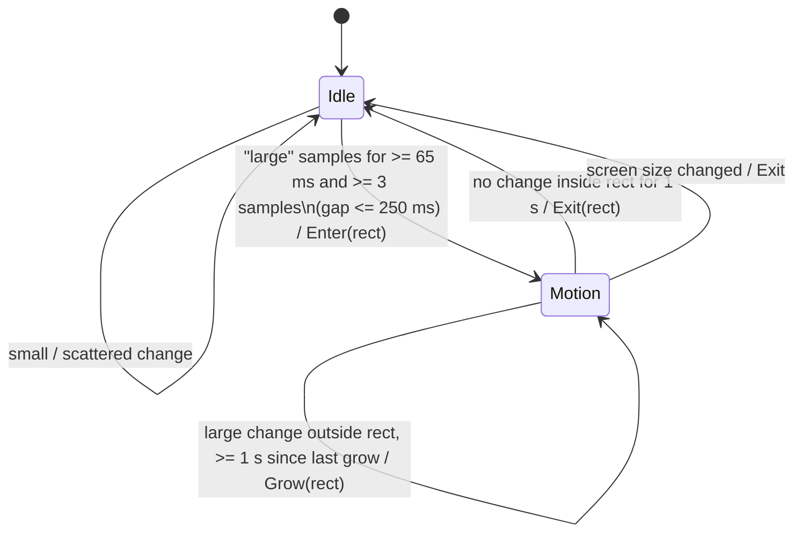
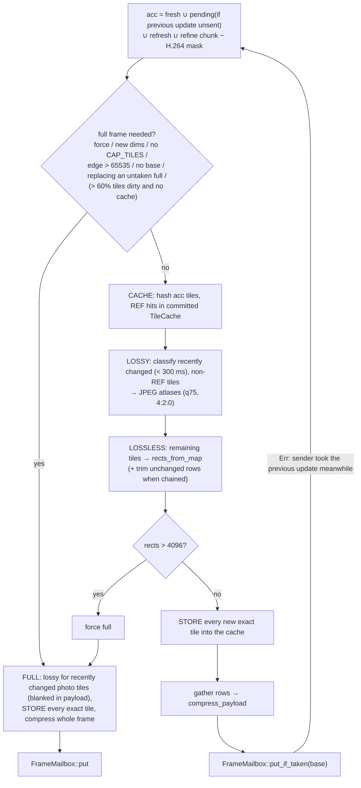
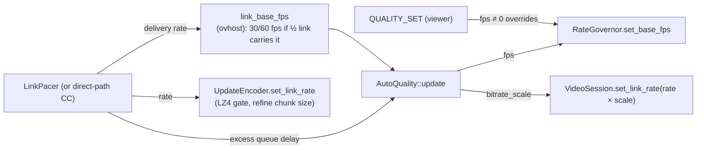
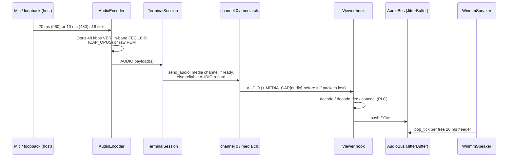

# OpenView media pipeline

This document follows a screen change and an audio tick from host capture to
viewer display. Everything here is derived from the code:

- mainly `crates/ovapp/src/` (see [`crates/ovapp.md`](crates/ovapp.md)
  for the reference tables)
- plus the wiring in `crates/ovhost/src/session/` (`capture_loop.rs`,
  `screen.rs`, `hooks.rs`) and `crates/ovview/src/session/`

File references are relative to `crates/`.

---

## 1. The big picture

There is a single encrypted command channel (AEAD record channel 0), with an
optional unreliable media side-channel when a direct UDP path is up.
Everything else is layered on that channel.

```mermaid
flowchart LR
  subgraph Host["ovhost (capture thread + session thread)"]
    CAP["Capture<br/>DXGI dup / GdiScreen"] --> ENC["UpdateEncoder::submit_ex<br/>(ovapp/src/sendq/)"]
    CAP --> VS["VideoSession::on_capture<br/>(ovapp/src/video/)"]
    ENC -->|"full frame / tile delta"| MB["FrameMailbox<br/>latest-wins slot + video FIFO"]
    VS -->|"H.264 AU / VIDEO_END"| MB
    MIC["Mic / WASAPI loopback"] --> AENC["AudioEncoder::encode_ticks"]
    MB --> PS["PrioritySender::flush<br/>control first, 1 update in flight"]
    PACER["LinkPacer<br/>(probe PING/PONG)"] -.window.-> PS
    AENC -->|"send_audio"| TS
    PS --> TS["TerminalSession::send<br/>AEAD record ch.0"]
    PS -->|"media_ready"| MEDIA["media channel<br/>(RS-FEC, unreliable)"]
  end
  TS -->|"relay / TCP / UDP(+RUDP) / direct"| NET(("network"))
  MEDIA --> NET
  subgraph Viewer["ovview / iOS ovffi"]
    NET --> PUMP["TerminalSession::pump"]
    PUMP --> SD["ScreenDecoder<br/>(ovapp/src/tiles/)"]
    PUMP --> VD["VideoRx + H264Decoder<br/>blit over framebuffer"]
    PUMP -->|"on_cmd hook"| ADEC["AudioDecoder -> AudioBus/JitterBuffer"]
    SD --> TAKE["take_latest_frame()"]
    VD --> TAKE
    TAKE --> SCALE["Scaler::area_sharpen / GPU"] --> WIN["window"]
    ADEC --> SPK["WinmmSpeaker"]
  end
```



Three ideas shape the whole design:

1. **Send less data.** The host sends only what changed: 64x64 dirty tiles
   instead of whole frames. It turns a scroll into a 12-byte MOVE, sends
   photo-like tiles as JPEG first and refines them later, reuses tiles the
   viewer already holds, and switches high-motion regions to H.264.
2. **Never queue stale pixels.** Screen updates go through a single
   *latest-wins* mailbox, so a slow link always gets the freshest capture,
   never a backlog. Only H.264 units, which form a reference chain, use a
   FIFO.
3. **Keep control traffic fast.** Control records (PONG, cursor, audio,
   input echo) always jump ahead of frame data. Frame data is also held back
   by a delay-based pacing window, so no standing queue builds up in the
   kernel or relay buffers.

---

## 2. Capability negotiation decides the format

When a session starts, the viewer sends `CAPS` and the host replies with its
own (see `TerminalSession::pump`, `Command::Caps` arm in
`ovapp/src/terminal/caps.rs`). The host's encoder follows the viewer's bits
(`UpdateEncoder::set_peer_caps`):

| Viewer advertises | Host may send |
|---|---|
| nothing (old peer) | DEFLATE full frames only (`FRAME_BEGIN` codec 1) |
| `CAP_TILES` | `TILES_BEGIN` deltas against `base_seq` |
| `CAP_ZSTD` | zstd payloads (single or concatenated frames) |
| `CAP_BANDS` (+`CAP_LZ4`) | the Packed band container, with per-band raw/DEFLATE/zstd/LZ4 |
| `CAP_MOVE` + `CAP_BANDS` | copy-rect MOVE records (scroll) |
| `CAP_LOSSY` + `CAP_BANDS` | JPEG atlases for photo-like tiles |
| `CAP_CACHE` + `CAP_BANDS` | tile-cache REF / STORE records |
| `CAP_H264` | `VIDEO_BEGIN` H.264 access units (needs a working decoder) |
| `CAP_OPUS` (+`CAP_AUDIO10`) | Opus audio, in 20 ms (or 10 ms) packets |
| `CAP_RUDP` | the UDP carrier switches to reliable framing |
| `CAP_DIRECT` + `CAP_MEDIA` (both sides) | direct UDP path, delay-based congestion control, unreliable media channel |

A default desktop viewer advertises:

- `LOCAL_CAPS | VIEWER_W2_CAPS | audio_caps()`
- plus `CAP_H264` once `set_video_decoder` installs the Media Foundation
  decoder (`ovview/src/session/mod.rs`)
- plus `CAP_DIRECT | CAP_MEDIA` when `enable_direct` is used

---

## 3. Host: from capture to an encoded update

### 3.1 Capture

`ovhost` grabs a frame with DXGI Desktop Duplication (`ovhost/src/dxgi.rs`),
falling back to `ovapp::gdisrc::GdiScreen` (BitBlt into a top-down 32-bit
DIB). Either way the result is tight BGRA. DXGI also supplies the OS **dirty
rects** (`hints`) and **move rects** (`os_moves`), and the host may keep a
GPU texture for zero-copy H.264 (`VideoSession::set_gpu_frame`).

The capture interval is chosen as follows:

- `RateGovernor` (`ovapp/src/adapt.rs`) snaps to the base fps on any change
  and eases toward `IDLE_FPS = 4` while the screen is static. Each idle step
  multiplies the interval by 1.5.
- The base fps comes from `AutoQuality`, or from a manual `QUALITY_SET`
  (section 6).

### 3.2 Change detection and tiling

`UpdateEncoder::submit_ex(px, w, h, hints, os_moves, mask, refresh, mailbox)`
(`ovapp/src/sendq/encoder.rs`) compares the capture with `last_px`, the host's mirror
of what the viewer will hold:

```
diff_tiles(last_px, px, ..., hints, &mut fresh)     // ovapp/src/tiles/mod.rs
  for each 64-px tile row with candidates:
    for each pixel row:  memcmp whole row; if different,
      compare only the not-yet-dirty candidate tiles of that row
```

Nothing changed, with no refresh owed and no refinement due ->
`SubmitOutcome::Unchanged`. Nothing is queued.

### 3.3 Scroll -> MOVE

The encoder looks for a MOVE only when all of these hold:

- the viewer has `CAP_MOVE | CAP_BANDS`
- the previous update has already been taken by the sender, so the viewer
  will hold exactly `last_px`
- no H.264 mask or refresh is involved

`find_move` then searches in two stages:

1. **OS move rects first.** Each is checked with `scroll::verify_move` and
   accepted when at least 90 % of its rows match.
2. **Then the detector,** but only when at least 8 tiles are dirty.
   `scroll::detect_vertical` runs over the bounding box of the dirty tiles:
   - it tightens the area to the changed columns, then hashes each row
   - it votes for a shift `|dy| <= H/2`, which needs at least 4 votes
   - it verifies rows exactly, bridging gaps of up to 8 rows
   - it accepts the result only with at least 16 matched rows that make up
     at least half of the run

When a move is found:

- It is applied to `last_px`.
- The tiles are re-diffed against the moved mirror, using hints, so `fresh`
  shrinks to the residual: typically the exposed strip.
- The move goes into the update's band container.

A 24 px scroll of a 1305x595 window becomes one MOVE plus a 1305x24 strip
(about 1 KB instead of about 78 KB, per the `bands/mod.rs` docs).

### 3.4 The H.264 region

After `submit_ex`, the host calls `VideoSession::on_capture` with the
encoder's `fresh` map (`ovhost/src/session/capture_loop.rs`). The `MotionDetector`
(`ovapp/src/video/motion.rs`) is a hysteresis state machine.



A sample counts as "large" when either:

- at least 25 % of all tiles are dirty, or
- the dirty bounding box covers at least 320x240 px, at least half of the
  tiles inside it are dirty, and the dirty tiles total at least half of
  320x240 px

A rect covering at least 60 % of the screen snaps to the full screen.

While in motion:

1. **Masking.** `UpdateEncoder` subtracts the motion rect (`mask`) from every
   delta, so the viewer shows video there. If every change is inside the
   mask, no tile update is sent at all.
2. **Encoder rect.** The coded rect is the motion rect rounded up to
   `ENCODER_BUCKET = 128` px, kept even, placed tile-aligned, and reused while
   the region grows inside it. The coded rect becomes the mask.
3. **Encoding.** `mfcodec::MfVideoEncoder`:
   - Uses hardware NVENC/AMF/QSV MFTs, falling back to the Microsoft software
     MFT.
   - Runs in low-latency mode: CBR, no B-frames, GOP of `fps*60`, Main
     profile.
   - Inputs:
     - **CPU path:** `bgra_to_nv12` (BT.709 limited range, multithreaded for
       pictures of at least 300k pixels).
     - **GPU path:** a D3D11 video processor converts the capture texture to
       NV12.
4. **Self-contained keyframes.** `ParamSetCache::fix` makes every IDR
   self-contained (SPS/PPS) and rewrites each SPS's VUI to say "BT.709,
   limited range", so decoders such as VideoToolbox do not guess BT.601.
5. **Bitrate.**
   - `target_bitrate_bpp` = `min(w*h*fps*0.2, 0.7 * link_rate*8)`, clamped
     to 0.5..=40 Mbit/s.
   - `link_rate` is the pacer's delivery rate scaled by
     `AutoQuality::bitrate_scale`.
   - The encoder is retargeted only on a change of more than 15 %.
6. **Queueing.** Access units go into the mailbox's **video FIFO**
   (`push_video`), never replaced. If 3 units are already queued
   (`MAX_VIDEO_QUEUE`), the capture is not encoded, and the bitrate adapts
   instead.
7. **Encoder failure.** The session stops video, and tiles are used for 5 s
   before video is retried.

When motion ends:

1. `VideoSession` queues a `VIDEO_END` marker (header only, flag
   `VIDEO_END`).
2. It hands the rect back through `take_refresh()`.
3. `ovhost` calls `UpdateEncoder::queue_refresh(rect)`. The region's tiles
   join the refinement backlog as already "settled", and the following
   updates send them losslessly, about 64 KB at a time.

The mailbox's **barrier** guarantees the order: a screen update created after
the END marker only leaves after the marker does.

> The `VideoSession` doc comment still describes step 3 as "call
> `submit_masked` again with it as the forced refresh". `ovhost` now uses
> `queue_refresh` plus a hint-free `submit_ex`.

### 3.5 Codec decision for a tile update

Inside `submit_ex`, a loop builds either a delta or a full frame:



`compress_payload` chooses the wire codec:

```
if viewer has CAP_BANDS:
    Packed container (bands/mod.rs):
      split into ~96 KiB bands (≤ 8, 4-byte aligned), compress in parallel:
        photo-like band (LZ4 ratio estimate < 1.6) and LZ4 allowed -> LZ4
        else zstd level 1 (CAP_ZSTD and zstd-encode build)
        else LZ4 (if allowed) else DEFLATE
        if not smaller than raw -> raw
      LZ4 allowed  <=>  CAP_LZ4 and link_rate >= 4 MB/s (~32 Mbit/s)
      + MOVE / CACHE / LOSSY sections
elif CAP_ZSTD and payload >= 192 KiB and zstd-encode:
    concatenated independent zstd frames (still FrameCodec::Zstd)
else:
    zstd level 1 (CAP_ZSTD + zstd-encode)  or  DEFLATE (fast)
```

The rationale comes from the code comments:

- LZ4 decodes roughly 10-20x faster than pure-Rust zstd but is about 15 %
  larger on photos. It therefore pays off only on fast links.
- zstd at level 1 is about 2x faster and about 45 % smaller than DEFLATE
  level 1 on desktop frames.

### 3.6 The refinement lane (lossy -> exact)

Tiles that are inexact on the viewer (JPEG tiles, video-painted tiles, and
lossy pixels carried by a MOVE) sit in `UpdateEncoder::backlog`.

A tile becomes eligible once it has been unchanged for `REFINE_DELAY =
300 ms`. Each update then carries a chunk of such tiles. A chunk is:

- at most `REFRESH_CHUNK_BYTES = 64 KiB`
- at most about `REFINE_SLICE = 15 ms` of link time at the pacer's rate
- at least `REFINE_MIN_CHUNK = 8 KiB`
- between 2 and 64 tiles

When the link is idle and refinement is due, `ovhost` calls `submit_refine()`
without a new capture. It polls every 4 ms while refinement is pending, and
every 20 ms otherwise.

---

## 4. Host: from the mailbox to the wire

```
FrameMailbox                       PrioritySender::flush(term, mailbox, max)
┌──────────────────────┐           1. probe PING if due (pacer; not on governed direct path)
│ slot: Option<update> │──take()──▶2. drain every control command
│ video: VecDeque<AU>  │           3. while frame budget left:
│ barrier counters     │                stop if carrier queues > 1 chunk  (link_backlogged)
└──────────────────────┘                stop if pacer window full        (LinkPacer::allow)
                                        next(): BEGIN → FRAME_DATA(4 KiB)… → FRAME_END
                                        (video AU → media channel when media_ready)
```

- **One update in flight.** The mailbox is consulted only after the previous
  update has fully drained. Until then, newer captures simply replace the
  slot.
- **Control first.** Control commands are re-checked before every frame
  record, so a PONG, cursor update or audio tick waits behind at most one
  4 KiB chunk.
- **Pacing.**
  - `LinkPacer` (`ovapp/src/pacing.rs`) slips a probe PING tagged
    `PROBE_TAG` into the stream every 20 ms while frames flow.
  - Each PONG acknowledges every byte sent before its PING.
  - The delivery rate is the median of the samples in a 1 s window (the max
    during startup), and the min RTT is taken over a 10 s window.
  - Frame records are released only while the estimated bytes in flight stay
    below `rate × (min_rtt + 15 ms)`.
  - Between acks, the path is assumed to drain at 1.25x the measured rate
    (2x during startup), which keeps probing for more bandwidth.
- **Direct v2 path.** When `term.transport_rate()` is `Some`, the
  transport's own delay-based controller paces, and the PING pacer is
  bypassed. Video access units then leave as `Outgoing::Media` on the
  unreliable, RS-FEC-protected media channel (`TerminalSession::
  send_video_media`). If the channel closes mid-stream, the unit is streamed
  reliably instead.

---

## 5. Viewer: from records to pixels

### 5.1 Reassembly

`TerminalSession::pump` decrypts each record and decodes the command.

1. `FRAME_BEGIN` or `TILES_BEGIN` opens an `UpdateMeta`.
2. `FRAME_DATA` chunks accumulate.
3. `FRAME_END(seq)` closes it:
   - Too few bytes -> the update is dropped, counted as a desync, and a
     `KEYFRAME_REQUEST` is sent (rate-limited to one per 300 ms).
   - Otherwise the update is queued in wire form (still compressed).

`VIDEO_BEGIN` follows the same path into `on_video_unit`. Media-channel units
arrive through `pump_media`.

Up to 4 completed updates are kept. The renderer calls `take_latest_frame()`
(`ovview/src/session/mod.rs`), which works like this:

- Updates older than the newest **full** frame are thrown away without being
  decompressed.
- Deltas after that full frame are applied in order.
- Video units are always decoded in order, because P-frames chain.
- The function returns one snapshot of the framebuffer.

### 5.2 Applying an update (`ScreenDecoder`, `ovapp/src/tiles/mod.rs`)

```
full frame:   decompress(codec) → replace framebuffer; clear cache slots & lossy map
delta:        require fb.seq == base_seq (else Desync → KEYFRAME_REQUEST)
              decompress → scatter rows into rects; fb.seq = seq
Packed:       parse container (strict) → validate everything →
              decode bands (parallel ≥ 128 KiB) + JPEG atlases (parallel) →
              apply: MOVEs → bands → cache REFs → atlases → cache STOREs
```

Plain zstd payloads made of several frames are decoded in parallel by
`zstd_par::decode_parallel`. This matters most on iOS, where the pure-Rust
`ruzstd` is about 3-4x slower than C zstd.

### 5.3 H.264 on the viewer

`VideoRx::accept` enforces continuity:

- A keyframe re-syncs the chain.
- An in-order P-frame is delivered.
- A gap -> drop the unit and send `VIDEO_IDR_REQUEST` (rate-limited to one
  per 300 ms).
- A unit older than one already seen -> `Stale`. It lost the race between
  the media and reliable channels and is dropped silently.
- `VIDEO_END` -> clears sync. The lossless refresh that follows overwrites
  the video pixels.

`H264Decoder` (Media Foundation, low-latency) produces NV12. `nv12_to_bgra`
converts it, and `ScreenDecoder::blit` paints it at `header.rect`. The tiles
it covers are marked lossy until exact pixels replace them.

Latency is measured as `unix_micros() − pts_us`, which needs synchronised
clocks or a single machine. Stalls are gaps of more than 100 ms between
pictures within one motion period. Both are recorded in `VideoRxStats`.

### 5.4 Display

`ovview/src/window/paint.rs` scales the framebuffer to the window. Its CPU path is
`ovapp::scale::Scaler::area_sharpen`:

- an area filter when shrinking and bilinear when enlarging
- then a 5-tap unsharp mask with k = 0.5
- 14-bit fixed point, banded across up to 8 threads

The iOS Metal shaders mirror this filter (per the `scale.rs` docs). The
cursor is drawn by the viewer from `CURSOR` (region-relative position, LE)
and `CURSOR_SHAPE` (BGRA bitmap of at most 64x64).

---

## 6. Adaptation loop



`AutoQuality` (`ovapp/src/adapt.rs`) reacts only to *excess* queueing delay,
meaning RTT above the path minimum. A long but stable relay RTT therefore
costs nothing.

| Excess queue delay | Response |
|---|---|
| < 50 ms | Restore fps (+25 % of base per second), then the bitrate scale (+0.2/s) |
| 50-150 ms | Lower the H.264 bitrate scale (−0.25/s, floor 0.5) and keep fps |
| > 150 ms | Lower the bitrate scale fast (−0.5/s); once it reaches the floor, cut fps by 30 %/s (floor 5 fps) |

The effect is that picture quality drops first, and frames are lost only
under sustained congestion. While H.264 is active, the AUTO base is at least
30 fps (`VIDEO_FPS`).

---

## 7. Audio path



- **Format** (`ovapp/src/audio/mod.rs`): `u8 codec | u8 flags | u32 samples (BE)
  | body`, 48 kHz mono.
  - Codec 0 carries s16le PCM (768 kbit/s).
  - Codec 1 carries one Opus packet (about 48 kbit/s).
- **Packet size.** 10 ms Opus packets (`CAP_AUDIO10`) halve the packetisation
  delay. `ovhost`'s WASAPI loopback (`ovhost/src/sysaudio.rs`) delivers 10 ms
  ticks.
- **Loss handling.** Over the reliable channel audio never loses packets. On
  the media channel, the pump synthesises `MEDIA_GAP{kind: audio, packets,
  samples}` before the next AUDIO. The viewer then recovers the lost audio
  from the next packet's FEC (`decode_fec`) or conceals it with Opus PLC
  (`conceal`).
- **Playback.** `JitterBuffer` prefills to its target, trims back to the
  target past its ceiling, and re-enters prefill after an underrun.
  - Defaults are 60/120 ms.
  - `ovview` uses `AudioBus::with_ms(30, 90)`.
  - `WinmmSpeaker` keeps 3 rotating 20 ms buffers.
- **Direction.** AUDIO is direction-agnostic, so viewer mic to host also
  works (`ovapp/tests/audio_duplex_over_relay.rs`).

---

## 8. Frame and tile formats at a glance

```
Record (AEAD, channel 0):  [12 B header][ 1 B opcode | payload ][16 B tag]   ≤ 65 507 B

Full frame:   FRAME_BEGIN(30 B) · FRAME_DATA × n · FRAME_END(seq)
Tile delta:   TILES_BEGIN(36 B + 8 B/rect) · FRAME_DATA × n · FRAME_END(seq)
H.264 unit:   VIDEO_BEGIN(38 B) · FRAME_DATA × n · FRAME_END(seq)       (reliable)
              VideoHeader(38 B) + Annex-B as one media-channel unit      (direct v2)

Delta payload (before compression): rows of rect 0 (top→bottom), rows of rect 1, …
Packed container: ver | flags | [MOVES] | [CACHE refs/stores] | [LOSSY atlases] | band table | bands
```

The byte-level tables are in [`crates/ovapp.md` §3.3 and §4.3](crates/ovapp.md).

---

## 9. Performance tuning knobs

| Knob | Where | Default | Effect |
|---|---|---|---|
| Capture base fps | `ovhost` CLI (`--fps`), `QUALITY_SET` | AUTO (`target_fps = 0`) | Manual value overrides `AutoQuality` |
| AUTO fps ceiling | `ovhost` `MAX_AUTO_FPS` (`--max-fps`) | 60 | Cap for `link_base_fps` |
| Idle capture rate | `ovhost` `IDLE_FPS`, `RateGovernor::IDLE_EASE` | 4 fps, ×1.5/step | Static-screen CPU cost vs pickup latency |
| Lossy tiles | `UpdateEncoder::set_lossy`, `ovhost --lossless` | on | JPEG-first for photo tiles |
| JPEG quality / chroma | `UpdateEncoder::set_lossy_params`, `lossy::DEFAULT_QUALITY` | 75, 4:2:0 | Size vs fidelity of the lossy pass |
| Tile cache | `set_cache`, `set_cache_slots` | on, 4096 slots | Up to 64 MB viewer RAM; window switching |
| Refinement timing | `REFINE_DELAY`, `REFINE_SLICE`, `REFRESH_CHUNK_BYTES` | 300 ms, 15 ms, 64 KiB | When and how fast lossy becomes exact |
| LZ4 gate | `LZ4_MIN_LINK_RATE`, `LZ4_MAX_RATIO` | 4 MB/s, 1.6 | Decode speed vs bytes on fast links |
| Bands | `TARGET_BANDS`, `MIN_BAND` | 8, 96 KiB | Encode/decode parallelism |
| Full-frame threshold | `FULL_FRAME_NUM/DEN` | 60 % | Delta vs full frame (ignored with the cache) |
| Frame chunk | `sendq::DEFAULT_CHUNK` (`ovhost` `FRAME_CHUNK`) | 4 KiB | Max control wait behind frame data |
| Pacing | `TARGET_QUEUE_DELAY`, `PROBE_INTERVAL`, `GAIN`; `LinkPacer::set_enabled` | 15 ms, 20 ms, 1.25 | Standing queue vs throughput |
| H.264 on/off/encoder | `ovhost --h264 auto\|hw\|sw\|off` (`H264_MODE`), `--gpu-encode` / `--no-gpu-encode` | auto | Motion path and GPU input |
| Motion thresholds | `MotionConfig` | 65 ms enter / 1 s exit, 320x240 | How eagerly regions switch to video |
| Video bitrate | `VideoSession::set_bits_per_pixel`, `target_bitrate_bpp` | 0.2 bpp, ≤ 70 % link, 0.5-40 Mbps | Quality vs link share |
| Video backlog | `MAX_VIDEO_QUEUE` | 3 | Latency vs skipped encodes |
| Audio packet | `CAP_AUDIO10` | 10 ms with `opus` | Latency vs overhead |
| Jitter buffer | `AudioBus::with_ms` | 60/120 ms (viewer 30/90) | Audio latency vs dropouts |
| Timer resolution | `netwait::high_res_timers()` | — | 1 ms waits for the pacer |

---

## 10. Known gaps and inconsistencies (as of this reading)

- `candidate_kind` never yields `CAND_UPNP`, although the constant exists and
  is documented.
- Stale doc comments:
  - the `OpCode::FrameBegin` comment in `terminal/command.rs` (old 25-byte
    layout).
  - `pacing::RATE_WINDOW` ("max-filter"; the code uses the median).
  - `scroll::MIN_ROWS` ("tile rows"; actually pixels).
  - `VideoSession` usage step 3.
  - `OPUS_FEC_LOSS_PERC` ("records travel reliably today").
  - `VideoRx::synced` ("waiting for a keyframe" describes `!synced`).
- The clipboard spec says kind 0 is non-empty text, but the code uses empty
  text as "clear".
